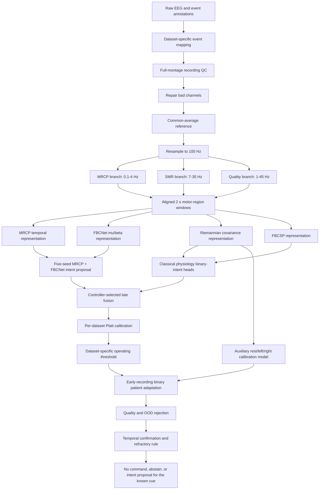

# Weak Motor-Intent EEG BCI: Complete Project and Presentation Guide

> **Current version:** Translational V7 auxiliary-direction intent. The
> device-facing output is binary `rest` versus `intent`; left/right labels are
> used only as optional internal calibration evidence. All V7 results remain
> development-observed rather than locked external confirmation.

## Purpose of This Guide

This document explains the complete project in presentation-ready language. It
describes the clinical question, datasets, EEG physiology, preprocessing,
features, machine-learning decoders, patient adaptation, safety logic,
evaluation, current results, limitations, and the major side experiments that
led to the current system.

Use it in three ways:

1. Read Sections 1-4 for the project story and a short presentation.
2. Read Sections 5-16 for a detailed technical understanding.
3. Use Sections 17-21 to prepare slides, answer questions, and review acronyms.

The most important distinction in this document is between an encouraging
offline research result and a clinically validated device. The project has a
strong, reproducible offline pipeline, but it has not yet completed prospective
patient testing, continuous no-control testing, or evaluation on a newly locked
external cohort.

---

## 1. The Project in One Minute

### Clinical problem

A rehabilitation brain-computer interface (BCI) should recognize when a person
is trying or imagining a movement and use that evidence to trigger assistance,
feedback, or a prosthetic command. This is difficult because noninvasive EEG is
weak, noisy, variable across people, and easily contaminated by eye, facial,
neck, electrode, and environmental artifacts.

The project therefore asks:

> Can a model trained on multiple EEG datasets detect weak hand motor intent in
> a previously unseen person, adapt using a small amount of that person's EEG,
> and remain conservative enough to limit false activations?

### Current approach

The system does not ask one model to solve everything at once. It separates the
problem into stages:

1. Clean and quality-check the full EEG recording.
2. Create slow motor-potential and sensorimotor-rhythm views of the same window.
3. Decide whether motor intent is present or absent.
4. Use known left/right cue labels only when they improve internal patient
   calibration; collapse them back to binary intent probability.
5. Calibrate probabilities and operating thresholds for each dataset and adapt
   to the individual using an early recording.
6. Reject artifact-like or out-of-distribution windows.
7. Require repeated temporal evidence before a future device command.

### Current headline result

The preferred exploratory V7 conservative candidate reached:

| Endpoint | Patient-adapted V7 result |
|---|---:|
| Intent balanced accuracy | **73.6%** |
| Intent sensitivity | **53.5%** |
| Intent specificity | **93.7%** |
| Intent AUROC | **0.896** |
| External output classes | **rest / intent** |

V7 reached 73.6% conservative balanced accuracy versus 73.3% for V5 and 71.9%
for the strict-binary V6. Its subject-bootstrap interval was 67.5-78.7%, so the
0.3-point advantage over V5 is not an independent confirmation. The auxiliary
direction contribution was selected for PhysioNet and OpenBMI but assigned
zero weight for Liu stroke data. V7 is therefore the preferred conservative
development candidate, not a proven universal improvement.

### Safest conclusion

The work supports a multi-branch, calibrated, patient-adaptive EEG intent gate.
It does not yet establish safe asynchronous prosthetic control. The next
claim-bearing study requires a frozen model, a new unseen cohort, continuous
no-control periods, and direct measurement of false activations per minute,
latency, and missed intents.

---

## 2. What the System Is Detecting

### Motor execution

Motor execution is an actual physical movement. The motor cortex prepares and
initiates the action, and the movement also produces muscle activity,
proprioceptive feedback, and movement artifact. Execution EEG can be easier to
separate than imagery, but it is not equivalent to pure cortical intent.

### Motor imagery

Motor imagery is the internal rehearsal of movement without overt muscle
contraction. It can alter sensorimotor rhythms and slow cortical potentials,
but the response is usually weaker and more variable than execution.

### Attempted movement

Attempted movement is especially important in rehabilitation. A person intends
and tries to move, but paralysis or weakness may prevent visible movement.
Attempted movement is not perfectly represented by healthy motor imagery. The
current project uses imagery as a practical development model and stroke EEG as
a translational test domain.

### Binary intent with a known requested movement

The current system uses the rehabilitation cue and EEG for different jobs:

```text
Visual or auditory cue: which movement is requested?
                         |
EEG question: did credible motor intent follow?
                         |
                         +-- No  -> remain at rest / issue no proposal
                         |
                         +-- Yes -> propose assistance for the cued movement
```

V7 may use `rest`, `left`, and `right` labels internally during training and
rapid calibration, but it converts the auxiliary output to
`P(intent) = P(left) + P(right)`. Direction is never exposed by the deployed
decoder. This design focuses the EEG problem on whether a command should exist
at all while preventing a weak direction head from becoming a device command.

### Cue-locked detection versus spontaneous detection

Most current examples are cue-locked. The experiment knows approximately when
the participant was asked to imagine a movement. This is easier than
asynchronous operation, where the system continuously monitors EEG and does not
know when intent will begin.

The current specificity is therefore cue-locked window specificity. It must not
be presented as false activations per minute during everyday use.

---

## 3. Complete Pipeline at a Glance



The present offline result is fully evaluated through the quality/OOD stage.
Temporal confirmation is implemented and connected to the final probability
source, but its continuous false-activation and latency performance is not yet
evaluated because the current data do not include suitable unrestricted
no-control recordings.

---

## 4. Why This Pipeline Was Chosen

### EEG motor intent is not represented by one feature

Motor intent can appear as both slow voltage changes and oscillatory changes:

| Physiological view | Approximate band | What it may reveal |
|---|---:|---|
| MRCP | 0.1-4 Hz | Slow movement preparation and intention-related potential |
| Mu rhythm | roughly 7-14 Hz | Sensorimotor rhythm suppression or rebound |
| Beta rhythm | roughly 14-30 Hz | Movement preparation, imagery, and post-movement changes |
| Spatial covariance | band dependent | Coordinated activity across motor-region channels |

A monolithic model can overfit whichever signal is easiest in one dataset. The
current pipeline instead gives different branches different responsibilities.

### Safety and sensitivity conflict

Raising an intent threshold reduces false activation but increases missed
intent. Lowering it detects more intended events but allows more false commands.
There is no threshold that maximizes both sensitivity and specificity.

The system therefore uses:

- Balanced accuracy to compare intent discrimination fairly.
- A conservative operating point for command safety.
- A sensitivity-targeted operating point for exploratory comparison.
- Probability calibration so a threshold has a more consistent meaning.
- Quality rejection and planned temporal confirmation to reduce false commands
  without relying only on an extreme probability threshold.

### Why patient adaptation matters

EEG varies because of anatomy, electrode placement, skull conductivity, stroke
location, medication, fatigue, strategy, and recording hardware. A general
model supplies a starting point, while early patient data adjust the model to
the individual. Later recordings remain untouched for evaluation.

---

## 5. Datasets and Their Roles

### PhysioNet EEG Motor Movement/Imagery Dataset

PhysioNet EEGMMIDB contains 109 healthy participants, 64 EEG channels, a 160 Hz
sampling rate, and repeated execution and imagery runs. The final translational
hand-intent pipeline uses unilateral hand imagery and paired protocol rest. It
does not treat bilateral hand/foot event codes as left/right labels.

Important event rule:

- In unilateral runs, T1 means left fist and T2 means right fist.
- In bilateral runs, T1 means both fists and T2 means both feet.
- Event meaning must therefore be resolved from the run type.

PhysioNet provides a large healthy reference, but its cue-driven rest is not
the same as unrestricted idle use.

### OpenBMI

OpenBMI contributes healthy left/right motor-imagery data and paired rest. It
adds independent participants, sessions, hardware, and experimental details.
This helps test whether a representation transfers beyond PhysioNet.

### Liu acute-stroke dataset

The Liu dataset contributes stroke-participant hand-imagery and protocol-break
examples. It is important because stroke EEG may differ substantially from
healthy EEG. One subject, `liu2024:S013`, was excluded by recording-level QC
because too many EEG channels were classified as bad before referencing.

### WAY-EEG-GAL

WAY-EEG-GAL contains synchronized EEG, EMG, kinematics, and force during upper-
limb movement. It was explored as a source of movement-related EEG and as an
unlabeled EEG pretraining source. It is not part of the final V7 inference input.

### Synchronized MRCP EEG-EMG source

A separate synchronized EEG-EMG dataset was used to test whether EMG-confirmed
movement timing could supervise an EEG-only student. EMG was used only in the
source cohort. Target predictions still accepted EEG only.

### Current V7 subject roles

| Dataset | Development | Controller validation | Development observed | Locked external |
|---|---:|---:|---:|---:|
| PhysioNet | 70 | 17 | 22 | 0 |
| OpenBMI | 18 | 5 | 6 | 0 |
| Liu stroke | 31 | 8 | 10 | 0 |

The 36,903-window translational cache contains 492 accepted recordings. One
recording or subject was excluded by QC.

### Why datasets are not blindly pooled

Dataset identity remains explicit because event timing, rest definition,
hardware, montage, cohort, and task instructions differ. Training uses shared
representations, but calibration and operating thresholds can be dataset
specific. This is safer than assuming every dataset is identically distributed.

---

## 6. Data Splitting and Leakage Prevention

### Development subjects

Development subjects are used to fit model weights, feature transformations,
normalization, and general representations.

### Controller-validation subjects

Controller subjects select fusion weights, calibration behavior, patient-
adaptation settings, and operating thresholds. The controller cohort is split
again so probability calibration and policy selection are not fitted on exactly
the same people.

### Development-observed subjects

These subjects provide the currently reported exploratory result. They were
previously examined during architecture development. They must not be called a
new untouched external test set.

### Locked external subjects

This role is intentionally empty. A future dataset or prospective cohort must
fill it before a confirmatory performance claim is made.

### Patient calibration boundary

For an evaluation participant, early-recording examples are used for personal
adaptation and later-recording examples are used for scoring. Later labels do
not select model settings.

### Why subject-level separation matters

Overlapping EEG windows from one person are highly correlated. A random
window-level split can place nearly identical data in training and testing and
produce an inflated result. This project assigns people, not windows, to major
roles.

### Pooled windows versus equal participants

Pooled metrics give participants with more usable windows more influence.
Equal-participant analysis first computes a metric per participant and then
averages participants equally. V7 reports subject-clustered bootstrap intervals
for this reason; its apparently small version-to-version differences should not
be interpreted without participant-level uncertainty.

---

## 7. Preprocessing in Detail

### 7.1 Load native montage

Each recording is loaded with its native EEG channels and normalized channel
names. When all positions can be recognized, the standard 10-05 electrode
montage is attached.

### 7.2 Recording-level channel quality control

Channel quality is assessed before average referencing. This ordering matters:
one extremely noisy channel can contaminate the average and spread its artifact
into every referenced channel.

The QC system looks for implausible channel behavior such as flat or highly
variable signals. Recordings with more than 25% bad EEG channels are rejected.

### 7.3 Bad-channel repair

When electrode positions are available, bad channels are repaired with
spherical-spline interpolation. If interpolation is unavailable or produces
non-finite values, a median-of-good-channels fallback is used. Every decision is
recorded in the QC metadata.

### 7.4 Common-average reference

After bad-channel repair, the mean signal across EEG electrodes is subtracted
from each EEG channel. This is common-average referencing (CAR). CAR reduces
activity shared broadly across the scalp and emphasizes spatial differences.

CAR is not a universal noise remover. Its quality depends on having enough
usable and reasonably distributed electrodes, which is why QC occurs first.

### 7.5 Resampling

Recordings are resampled to 100 Hz. This creates a common rate across datasets
and reduces computation. A 2-second window then contains 200 samples per
channel.

### 7.6 Parallel frequency branches

The same cleaned recording is filtered into three aligned views:

| Branch | Band | Purpose |
|---|---:|---|
| MRCP | 0.1-4 Hz | Preserve slow preparation-related voltage changes |
| SMR | 7-35 Hz | Preserve mu and beta sensorimotor rhythms |
| Quality | 1-45 Hz | Quantify amplitude and artifact-related behavior |

The offline filters are fourth-order Butterworth IIR filters with zero-phase
application. Zero-phase filtering avoids phase delay by using future data, so
it is appropriate for offline analysis but not for live use. A future online
version must use causal filters and measure their delay.

### 7.7 Spatial representation

After full-montage cleaning and referencing, the model uses seven shared motor-
region channels:

```text
FC3, FC4, C3, Cz, C4, CP3, CP4
```

The SMR branch can also compute current source density (CSD) when a sufficiently
complete montage is available. CSD is a spatial derivative that emphasizes
local cortical activity and reduces broad volume-conducted activity. It is one
available physiology view, not a replacement for every other representation.

### 7.8 Window extraction

The final translational dataset uses aligned 2-second windows. A typical intent
window begins after the cue to reduce immediate visual-transient contamination.
Dataset-specific timing remains explicit because the protocols differ.

### 7.9 Hard amplitude rejection and quality features

Extremely large windows can be rejected. The quality branch records features
including maximum and median peak-to-peak amplitude, RMS amplitude, maximum
absolute amplitude, mean absolute signal difference, and auxiliary-channel
amplitude when EOG or EMG channels exist.

### What is not automatically applied

ICA and ASR were researched and diagnostic tooling exists, but neither is
automatically part of the final V7 preprocessing contract.

- ICA can isolate ocular or muscle-related components, but automatic component
  removal can also delete neural signal and may be unstable on short recordings.
- ASR can repair nonstationary high-amplitude bursts, but it depends on a valid
  clean calibration distribution and requires controlled ablation.
- A notch filter is not automatically required after a 35 Hz low-pass because
  50/60 Hz line frequency lies outside the retained SMR band. Measured spectra
  should determine whether additional line-noise handling is needed.

---

## 8. EEG Representations and Extracted Features

### 8.1 MRCP features

MRCP stands for movement-related cortical potential. It is a slow change in
cortical voltage associated with preparation and movement. The feature branch
summarizes the trajectory in 0.5-second bins, slope, extrema, and central
laterality.

Why it helps: slow preparation evidence can exist even when mu/beta
desynchronization is weak.

Limitation: slow drift, eye activity, and cue-related potentials can resemble
MRCP, so timing and quality controls are essential.

### 8.2 Mu and beta power

Motor imagery commonly produces event-related desynchronization (ERD), a
reduction in synchronized mu or beta power relative to a reference period.
Event-related synchronization (ERS) is an increase or rebound.

The current SMR filter bank is:

```text
7-10 Hz, 10-14 Hz, 14-22 Hz, 22-30 Hz
```

Dividing mu and beta into narrower bands lets the model handle individual
differences better than one broad 8-30 Hz average.

### 8.3 Riemannian covariance

A covariance matrix summarizes how channels vary together. Covariance matrices
are symmetric positive-definite objects that lie on a curved geometric space,
not an ordinary flat vector space. Riemannian methods respect that geometry and
map the matrices into a tangent space for conventional classification.

Why it helps: spatial relationships can transfer more robustly than individual
voltage samples, especially with limited EEG data.

### 8.4 FBCSP

Filter-bank common spatial patterns (FBCSP) filters EEG into multiple frequency
bands and learns spatial projections that maximize variance for one class while
minimizing it for another. Log-variance features from these projections are
then classified.

In this project, FBCSP remains especially useful for conditional left/right
direction evidence.

### 8.5 FBCNet representation

FBCNet is a neural analogue of filter-bank spatial processing. The implemented
branch uses fixed mu/beta filters, learned spatial convolutions, segmented
variance, and logarithmic aggregation. It has a strong physiological inductive
bias rather than asking an unrestricted network to discover the entire signal
processing chain from scratch.

### 8.6 Morlet wavelets

A Morlet wavelet is a sinusoid tapered by a Gaussian envelope. Convolution with
Morlet wavelets estimates how frequency-specific power changes over time.
Wavelets are well suited to nonstationary EEG because they preserve both time
and frequency information.

Morlet features and visualizations were extensively audited. They helped show
where mu/beta activity changed, but simply concatenating more Morlet and PSD
features did not reliably improve locked performance. In one three-dataset
ablation, Morlet alone reached 69.5% balanced accuracy while Welch PSD alone
reached 57.0%; direct PSD-plus-Morlet fusion reached 65.9%. More features were
not automatically better.

### 8.7 Welch power spectral density

Welch PSD divides a signal into overlapping segments, computes periodograms,
and averages them to estimate power by frequency. It is stable and interpretable
but largely discards when a change occurred within the window.

PSD is valuable for QC, band selection, and visual explanation. It was weaker
than time-resolved or covariance representations as a standalone intent feature
in the controlled project ablation.

### 8.8 Feature atlas and extended features

Earlier experiments created a large feature atlas containing MRCP, bandpower,
Morlet trajectories, CSD, covariance, asymmetry, ERD morphology, quality, and
spectral features. Controlled ablations were then used to test whether each
family added value. This prevented a large feature count from being mistaken
for better information.

---

## 9. The MRCP + FBCNet Neural Intent Model

### Two-stream design

The selected neural model receives both the MRCP and SMR versions of each EEG
window.

```text
MRCP window -> spatial convolution -> temporal convolutions -> summary statistics
                                                                  |
                                                                  +-> concatenate
                                                                  |
SMR window  -> fixed filter bank -> learned spatial filters -> log variance
                                                                  |
                                                                  v
                                                         binary intent head
```

The MRCP branch learns slow spatial-temporal patterns. The FBCNet branch learns
band-specific spatial power patterns. Their embeddings are concatenated and
passed to a small two-class head.

### Model size

The complete model has 18,166 trainable parameters. This is intentionally small
for EEG. A compact model reduces overfitting risk and is practical for future
real-time inference.

### Five-seed ensemble

Neural training depends on random initialization, dropout, masking, and batch
ordering. The project trained seeds 42, 43, 44, 45, and 46 under the same data
contract. Their probabilities are averaged before fusion and calibration.

An ensemble reduces dependence on one lucky or unlucky initialization. It does
not create new independent patient evidence, which is why participant-level
validation remains necessary.

### Bakeoff result

| Model | BA mean | Sensitivity | Specificity | AUROC |
|---|---:|---:|---:|---:|
| **MRCP + FBCNet** | **62.66%** | **31.29%** | **94.03%** | **0.804** |
| ShallowConvNet | 62.63% | 30.45% | 94.81% | 0.782 |
| Target-only Conv1D | 60.63% | 27.49% | 93.78% | 0.746 |
| FBCNet alone | 56.94% | 20.34% | 93.54% | 0.683 |
| Conv1D with WAY SSL | 56.29% | 19.59% | 93.00% | 0.683 |

MRCP + FBCNet was the only neural candidate to pass every predeclared
advancement check. Its participant-mean improvement over target-only Conv1D was
3.10 points, with a 95% participant-bootstrap interval from 1.50 to 4.73; 76.3%
of participants improved in that architecture bakeoff.

---

## 10. Fusion, Calibration, and Patient Adaptation

### Late fusion

Late fusion combines model probabilities rather than concatenating every raw
feature. Controller-validation subjects retained these V7 population-intent
weights:

| Intent source | Weight |
|---|---:|
| MRCP + FBCNet ensemble | 60% |
| Riemannian branch | 25% |
| SMR statistical branch | 15% |

The population controller did not select the raw auxiliary-direction branch.
Direction labels enter only through rapid patient calibration, where the
controller can choose an auxiliary weight of 0.00, 0.25, or 0.50. This keeps
the external decision binary and lets a domain reject direction information
when it does not transfer.

### Probability calibration

A raw model score is not necessarily a trustworthy probability. Platt scaling
fits a logistic mapping from raw score to calibrated probability. The project
fits calibration by dataset and uses controller-selected shrinkage toward the
identity mapping when calibration evidence is weak.

Calibration does not improve ranking automatically. It improves the meaning of
the probability and supports more defensible threshold selection.

### Operating point

An operating point is the chosen probability threshold and policy at which the
system runs.

- Conservative point: prioritizes specificity and low false activation.
- Sensitivity-targeted point: allows more detections for exploratory analysis.

The conservative patient-adapted point is the preferred current candidate.

### Patient adaptation

The model uses examples from recording 0 to create a local patient head or
probability adjustment. Later recordings are evaluation-only, and every
calibration row is excluded from scoring. V7 compares 2, 5, and 10 examples per
source class (`rest`, `left`, and `right`), local/global blend weights, and
auxiliary weights on controller participants. The selected configuration uses
10 windows per source class and a 0.50 local blend in all three datasets.
Auxiliary weights are 0.25 for PhysioNet, 0.50 for OpenBMI, and 0.00 for Liu.

Patient adaptation is not simply retraining a large neural model on a few
trials. It is a controlled blend between population evidence and local evidence,
which reduces overfitting risk.

---

## 11. Quality, OOD Rejection, and Temporal Safety

### Quality gate

The quality gate rejects windows with implausible amplitude or artifact-like
features. Rejection produces abstention, not a class prediction.

### Out-of-distribution rejection

OOD means out of distribution. An OOD window differs substantially from the
training or calibration distribution. Examples include disconnected
electrodes, unusual movement artifact, a different sensor arrangement, or a
physiological state poorly represented in training.

An OOD gate prevents the model from converting unfamiliar input into an
overconfident command. It cannot guarantee safety because an artifact can still
look statistically familiar.

### Abstention

Abstention means the system declines to decide. In a rehabilitation controller,
abstention is usually safer than forcing every window into rest, left, or right.
Availability should always be reported alongside accuracy because an apparently
accurate model could reject most data.

### Temporal confirmation

The prepared V7 controller requires three qualifying windows before
confirmation. It also uses a 2-second refractory period after a command. The refractory period
prevents repeated commands from one sustained event.

Temporal confirmation can reduce isolated false positives without raising the
single-window threshold as aggressively. The tradeoff is additional latency and
possible missed short intents.

### Current boundary

There is no suitable continuous no-control recording in the current final
contract. Therefore:

- False activations per minute are not evaluated.
- Command latency is not evaluated.
- Temporal confirmation status is `prepared_not_evaluated`.
- Cue-locked false-positive fraction is not converted into a deployment rate.

---

## 12. How the Metrics Work

Assume motor intent is the positive class and rest/no intent is the negative
class.

### True and false outcomes

| Term | Meaning |
|---|---|
| True positive (TP) | Intent occurred and the gate detected it |
| False negative (FN) | Intent occurred but the gate missed it |
| True negative (TN) | No intent occurred and no intent was detected |
| False positive (FP) | No intent occurred but intent was detected |

### Sensitivity

```text
Sensitivity = TP / (TP + FN)
```

Sensitivity is the fraction of true intent windows detected. The missed-intent
rate is `1 - sensitivity`.

### Specificity

```text
Specificity = TN / (TN + FP)
```

Specificity is the fraction of no-intent windows correctly rejected. The false-
positive rate is `1 - specificity`.

### Balanced accuracy

```text
Balanced accuracy = (sensitivity + specificity) / 2
```

Balanced accuracy gives equal importance to intent and no intent even if one
class has more windows. A binary balanced accuracy of 50% is chance-level
discrimination at the selected threshold.

### Ordinary accuracy

```text
Accuracy = all correct predictions / all predictions
```

Accuracy can be misleading with class imbalance. A model that predicts only
rest can appear accurate if rest dominates the data.

### Precision and F1 score

Precision is the fraction of predicted intent windows that were truly intent.
F1 is the harmonic mean of precision and recall/sensitivity. Both depend on
class prevalence, so values can change when the proportion of rest changes.

### AUROC

The area under the receiver operating characteristic curve measures ranking
across all thresholds. A value of 0.5 is chance and 1.0 is perfect ranking.
AUROC does not identify the final safe operating threshold.

### AUPRC

The area under the precision-recall curve emphasizes positive-class detection
and can be more informative when intent is rare. Its baseline depends on class
prevalence.

### Brier score

The Brier score is the mean squared difference between predicted probability and
the true binary outcome. Lower is better. It evaluates both discrimination and
probability calibration.

### Expected calibration error

Expected calibration error (ECE) compares predicted confidence bins with their
observed frequencies. Lower is better. ECE depends on binning choices and should
not be used alone.

### Conditional direction balanced accuracy

This historical diagnostic measures left/right discrimination on the
intended-task subset. V3-V5 used it to evaluate direction heads, but V7 does not
expose a direction prediction. In V7, left/right labels are evaluated only by
whether their collapsed auxiliary evidence improves later binary intent
detection.

### Confidence interval

A confidence interval describes uncertainty from the observed sample. The
project resamples participants, not independent windows, because windows from
one participant are correlated.

### False activations per minute

This is the number of false confirmed commands divided by continuous no-control
recording time. It cannot be inferred safely from balanced cue-locked trials.

### Latency

Latency is the elapsed time between intent onset and confirmed command. It must
include window length, update interval, causal filter delay, confirmation, and
computation.

---

## 13. Current Results and Interpretation

### Current population and patient-adapted results

| Configuration | BA | Sensitivity | Specificity | AUROC |
|---|---:|---:|---:|---:|
| Population conservative | 70.6% | 47.6% | 93.6% | not primary |
| Population sensitivity-targeted | 75.7% | 71.8% | 79.6% | not primary |
| ShallowConvNet five-seed ensemble | 65.1% | 35.3% | 95.0% | not primary |
| MRCP + FBCNet five-seed ensemble | 66.9% | 37.9% | 95.9% | not primary |
| **V7 patient-adapted conservative** | **73.6%** | **53.5%** | **93.7%** | **0.896** |
| V7 patient-adapted sensitivity-targeted | 74.1% | 58.5% | 89.6% | same ranking model |

The population model remains important: V7 does not require local calibration
to produce an intent probability. Rapid adaptation improves the conservative
later-recording result from 69.1% matched-population BA to 73.6% BA on the same
evaluation rows and operating thresholds.

### V5, V6, and V7

| Version | Calibration design | BA | Sensitivity | Specificity |
|---|---|---:|---:|---:|
| V5 | Directional adaptation inputs | 73.3% | 52.9% | 93.8% |
| V6 | Strict binary, 20 total windows | 71.9% | 49.1% | 94.7% |
| **V7** | Optional auxiliary direction, 30 total windows | **73.6%** | **53.5%** | **93.7%** |

V7 gives the strongest conservative point, but only by 0.3 points over V5.
V6 remains useful when a smaller, simpler rest/intent calibration is preferred.
At the sensitivity-targeted operating point, V5 and V6 remain slightly ahead
of V7 in balanced accuracy, so V7 is not universally best at every threshold.

### Domain-specific patient-adapted V7 result

| Dataset | BA | Sensitivity | Specificity | Auxiliary weight |
|---|---:|---:|---:|---:|
| PhysioNet | 63.8% | 40.7% | 86.9% | 0.25 |
| OpenBMI | 76.3% | 57.3% | 95.3% | 0.50 |
| Liu stroke | 65.0% | 40.5% | 89.5% | 0.00 |

The zero Liu auxiliary weight shows why the auxiliary branch must be optional.
Direction structure that helps healthy datasets did not provide reliable
additional stroke calibration evidence. The pooled result also hides major
domain variation, particularly PhysioNet's lower specificity.

### Participant-level uncertainty

| V7 conservative endpoint | Subject-bootstrap 95% interval |
|---|---:|
| Balanced accuracy | 67.5-78.7% |
| Sensitivity | 41.4-65.8% |
| Specificity | 89.7-96.1% |

The intervals are wide and overlap earlier versions. The result identifies the
best current development configuration, not a proven average improvement for a
future patient.

### Recommended presentation wording

> The V7 patient-adapted binary intent candidate achieved 73.6% balanced
> accuracy with 53.5% sensitivity and 93.7% specificity on later recordings
> from the development-observed cohort. Optional left/right calibration evidence
> was retained for PhysioNet and OpenBMI but rejected for Liu stroke data. No
> locked external or continuous no-control result is available, so V7 remains
> an exploratory cue-locked development result rather than a validated device
> controller.

---

## 14. Side Experiments and What We Learned

### 14.1 Initial statistical MLP

The original three-class statistical MLP converged near a loss of 1.0986 and
predicted only rest. Its ordinary accuracy was 49.94%, but left- and right-fist
recall were both zero.

Lesson: ordinary accuracy concealed total motor-class collapse. The project
moved toward balanced metrics, subject isolation, hierarchical decoding, and
better physiological representations.

### 14.2 SVM and random-forest wavelet baselines

Classical SVM and random-forest models on wavelet statistics produced roughly
60% left/right performance in early experiments. A NaN failure also exposed the
need for finite-value validation and imputation or rejection before fitting.

Lesson: classical models are valuable baselines, but trial construction,
missing-value handling, and subject-level splits matter as much as model choice.

### 14.3 Movement versus imagery dual pipeline

Execution and imagery were processed with matched pipelines. Unilateral
movement achieved 55.4% multiclass balanced accuracy and 72.7% intent balanced
accuracy, while unilateral imagery achieved 44.3% and 57.1%, respectively.
Bilateral movement also outperformed bilateral imagery.

Lesson: imagery is measurably weaker and more variable than execution under a
matched analysis. Movement data are useful physiological context, but pooling
movement and imagery as if they were the same target can introduce artifact and
task mismatch.

### 14.4 Morlet, PSD, ERD, CSD, and feature-atlas studies

The project extracted and visualized raw EEG, filtered EEG, PSD, Morlet
time-frequency power, ERD/ERS, scalp spatial patterns, covariance, asymmetry,
and morphology. These experiments improved interpretation and identified useful
branches, but large concatenated feature vectors did not consistently improve
held-out results.

Lesson: feature extraction should be hypothesis-driven and verified by
controlled ablation. Visualization value and predictive value are related but
not identical.

### 14.5 Patient-adaptive covariance prototype

An early source-to-patient covariance experiment reached only about 46%
balanced accuracy after small calibration budgets.

Lesson: patient adaptation cannot rescue a weak event/window contract or a
poorly calibrated global representation. Adaptation was redesigned as one stage
inside a broader quality-aware pipeline.

### 14.6 Evidence accumulation and OOD rejection

The project explored probability evidence accumulation, quality rejection,
abstention, and confirmed-command rules to reduce false activation.

Lesson: reducing false commands should not rely only on increasing a threshold.
Independent quality evidence and repeated temporal evidence offer a more useful
safety architecture, but require continuous recordings for honest evaluation.

### 14.7 Healthy-to-stroke and multi-dataset harmonization

PhysioNet, OpenBMI, and Liu were harmonized to a shared hand-intent contract
while retaining dataset identity. Performance remained domain dependent.

Lesson: more data are useful only when labels, channels, timing, and negative
states are compatible. Domain-specific calibration is necessary.

### 14.8 Classical statistical, PSD, and Morlet fusion ablation

Welch PSD alone was weaker than the Morlet branch, and direct fusion did not
produce the strongest result. Morlet recovered sensitivity in some operating
points but often increased false activation.

Lesson: combining PSD and wavelets can add redundant or noisy dimensions.
Controller-selected late fusion is preferable to unconditional concatenation.

### 14.9 EMG-supervised EEG transfer

EMG-confirmed source training changed pooled balanced accuracy from 53.0% to
53.3%. The equal-participant change was +0.4 points with a 95% interval from
-0.1 to +0.9.

Lesson: synchronized EMG is useful for defining movement onset and validating
source examples, but physical-movement EEG does not automatically transfer to
imagery intent. The result demonstrated feasibility, not a reliable gain.

### 14.10 WAY privileged transfer

WAY EEG/EMG/kinematic supervision increased AUROC from 0.683 to 0.697 but left
conservative balanced accuracy essentially unchanged at about 53%. Some domains
improved while OpenBMI declined.

Lesson: a better ranking score does not guarantee improvement at a conservative
operating threshold, and overt reach data are not identical to imagined hand
intent.

### 14.11 Multi-source privileged ensemble

The validation-selected multi-source method reached 52.98% balanced accuracy,
11.00% sensitivity, 94.96% specificity, and 0.698 AUROC in its specific feature
contract. Its equal-participant change was +0.92 points.

Lesson: dataset-specific selection helped modestly, but privileged movement
sources did not solve the weak-intent problem.

### 14.12 WAY EEG-only self-supervised learning

Masked reconstruction pretraining reached 56.29% balanced accuracy across five
seeds and beat a normalization-matched random-initialization control by 2.81
points. A later strict target-development-only Conv1D baseline reached 60.63%,
revealing that source-derived scaling was a material confound.

Lesson: repeated seeds are necessary, and preprocessing must be independently
fitted for a fair transfer comparison. A positive paired effect does not prove
the transferred model is better than a correctly normalized target-only model.

### 14.13 Neural decoder bakeoff

EEGNet, ShallowConvNet, FBCNet, Conv1D, WAY SSL, and MRCP + FBCNet were compared
under one five-seed contract. MRCP + FBCNet was the only model to pass all
advancement checks.

Lesson: motor-physiology inductive bias was more useful than simply increasing
network complexity. The selected model combined slow intent and oscillatory
sensorimotor evidence.

### 14.14 V4 neural integration

The winning neural proposal was fused with Riemannian and SMR evidence, then
calibrated, patient adapted, quality gated, and connected to temporal safety.

Lesson: the strongest result came from integrating complementary components,
not replacing the complete pipeline with one neural network.

### 14.15 V5-V7 patient-adaptation progression

V5 integrated two five-seed neural proposals with rapid patient adaptation and
retained direction-derived inputs. V6 removed direction and used a uniform
20-window binary calibration. V7 restored left/right labels only as optional
privileged calibration evidence while keeping the external output binary.

Lesson: the strongest conservative result came from a compromise. Direction
information can help healthy-domain calibration, but it must be gated by
controller evidence and was correctly assigned zero weight for Liu stroke
data. The gain over V5 is small, so calibration burden and external validation
matter more than declaring one universally superior version.

---

## 15. What Worked, What Did Not, and Why

### Components worth retaining

- Subject-disjoint development and controller roles.
- Explicit dataset/event contracts.
- Full-montage QC before common-average referencing.
- Separate MRCP, SMR, covariance, optional auxiliary-direction, and quality
  branches.
- Strictly binary `rest` versus `intent` deployment output.
- Known cue direction separated from EEG intent confirmation.
- Five-seed MRCP + FBCNet intent proposal.
- Controller-only late fusion and probability calibration.
- Early-recording patient adaptation with later-recording evaluation.
- OOD rejection, abstention, and prepared temporal confirmation.
- Participant-level bootstrap analysis in addition to pooled windows.

### Approaches that did not provide a dependable gain

- Naive three-class MLP training on imbalanced or weak statistical features.
- Treating ordinary accuracy as the main endpoint.
- Assuming more hand-engineered features always improve classification.
- Directly combining Welch PSD and Morlet features without controlled selection.
- Treating overt movement or EMG-confirmed EEG as equivalent to motor imagery.
- Accepting a self-supervised result without an independently normalized target
  control.
- Selecting a model only from pooled accuracy while ignoring domain and
  participant effects.

### Remaining bottleneck

The current conservative system has high specificity but modest sensitivity.
It misses nearly half of true intent windows. This may reflect weak physiology,
cross-subject variability, imperfect timing, cue confounds, negative-state
mismatch, stroke heterogeneity, and the limits of cue-locked public datasets.

---

## 16. Limitations and Next Research Steps

### 16.1 Freeze the current candidate

Architecture, preprocessing, fusion, and thresholds should be frozen before a
new claim-bearing cohort is evaluated. Continued tuning on the same observed
participants would convert them into development data.

### 16.2 Collect continuous no-control data

Record natural idle periods, transitions, distraction, eye movement, speaking,
jaw or neck contraction, electrode disturbances, and non-command movement.
Report confirmed false activations per minute rather than only window
specificity.

### 16.3 Perform structured clinical calibration

A future session can present visual or auditory left, right, and rest commands
with precise timestamps. Calibration should include:

- Rest and no-control baseline.
- Observation-only trials.
- Motor imagery or attempted-movement trials.
- Active movement when possible.
- Artifact challenge periods.
- Early calibration blocks and later untouched evaluation blocks.

### 16.4 Validate the causal online profile

Replace zero-phase filtering with causal filtering, maintain a streaming buffer,
measure filter delay, and evaluate the exact temporal confirmation policy.

### 16.5 Personalize physiology safely

Estimate individual mu peak, affected hemisphere, comfortable strategy, and
usable channels only from calibration data. Do not use evaluation labels for
personalization.

### 16.6 Evaluate clinically meaningful endpoints

Future primary endpoints should include:

- False activations per minute or hour.
- Intent sensitivity and missed-intent rate.
- Command latency.
- Abstained fraction and usable-session time.
- Direction accuracy after intent confirmation.
- Patient calibration burden.
- Day-to-day stability.
- Functional task success with assistance.

### 16.7 Consider hybrid sensing when available

For users with reliable residual muscle activity, EMG may provide a stronger and
faster control signal. EEG is most important when useful muscle activity is
absent, when detecting cortical effort itself is a therapeutic goal, or when
feedback should be contingent on brain engagement. A future hybrid controller
could use EEG for cortical intent and EMG for confirmation without requiring EMG
for every user.

---

## 17. A Suggested Presentation Structure

### Slide 1: Motivation

Title: Detecting Weak Motor Intent from EEG for Rehabilitation BCIs

Explain that the aim is not simply high offline accuracy. The aim is useful
intent detection with low false activation in unseen and potentially impaired
users.

### Slide 2: Why the problem is difficult

Show weak motor physiology versus ocular, muscle, electrode, and environmental
noise. Introduce inter-participant and healthy-to-stroke domain shift.

### Slide 3: Research question

State the exact question from Section 1. Define motor imagery, attempted
movement, intent, and no intent.

### Slide 4: Datasets

Show PhysioNet, OpenBMI, and Liu as the main translational datasets. Show WAY and
MRCP EEG-EMG as exploratory source datasets rather than final deployment inputs.

### Slide 5: Preprocessing

Show raw EEG, repaired/referenced EEG, MRCP, SMR, and quality views. Emphasize QC
before CAR and the seven common motor-region channels.

### Slide 6: Physiological representations

Show MRCP, mu/beta ERD, covariance, and FBCSP/FBCNet. Explain why no single view
captures all intent evidence.

### Slide 7: Binary model and safety controller

Show the binary intent gate, optional auxiliary-direction calibration,
per-domain calibration, patient adaptation, OOD rejection, and temporal
confirmation. Emphasize that the cue supplies direction and EEG only confirms
intent.

### Slide 8: Decoder bakeoff

Use the architecture comparison figure. Explain that MRCP + FBCNet was the only
candidate passing every predeclared check.

### Slide 9: V5 versus V6 versus V7

Present the conservative V7 result of 73.6% BA, 53.5% sensitivity, 93.7%
specificity, and 0.896 AUROC. Show that V7 is only 0.3 points above V5 and
explain the larger 30-window calibration burden.

### Slide 10: Domain results

Show PhysioNet, OpenBMI, and Liu separately. Explain that performance is not
uniform and PhysioNet exceeds the desired cue-locked false-positive fraction.

### Slide 11: Lessons from side experiments

Summarize movement versus imagery, feature ablations, EMG supervision, WAY SSL,
and the architecture bakeoff. Focus on lessons rather than listing every script.

### Slide 12: Limitations and next study

State that no continuous no-control or locked external result exists. Propose a
frozen prospective study with calibration, artifact challenges, asynchronous
testing, and causal deployment.

---

## 18. Likely Questions and Strong Answers

### Why not report only accuracy?

Rest can dominate EEG datasets. A model can obtain apparently acceptable
accuracy while never detecting intent. Balanced accuracy, sensitivity, and
specificity expose that failure.

### Why is conservative sensitivity only 53.5%?

The selected operating point intentionally protects specificity. Weak imagery,
participant variability, stroke domain shift, and strict artifact handling also
reduce sensitivity. The project reports this tradeoff rather than hiding it.

### Is 93.7% specificity safe enough for a prosthetic?

Not by itself. It is cue-locked window specificity, not continuous confirmed
commands per minute. Real safety requires unrestricted idle recordings and the
complete temporal controller.

### Why use both deep learning and classical methods?

They capture complementary information. The compact neural model learns MRCP
and filter-bank spatial patterns, while Riemannian covariance and SMR features
provide stable spatial physiology. Controller-selected population fusion uses
both families; optional direction evidence is restricted to patient
calibration and can be assigned zero weight.

### Why not use a larger transformer?

The limiting factors are not only model capacity. Dataset mismatch, noisy
labels, weak physiology, and small independent participant counts create high
overfitting risk. A compact physiology-informed model is a more defensible first
choice.

### Did EMG data improve the EEG model?

Only slightly and inconsistently. EMG improved source timing confidence, but
overt movement EEG did not transfer reliably to imagery. EMG remains useful for
future hybrid or teacher-label experiments, not as proof of a current gain.

### Are eye and muscle artifacts removed by ICA?

Not automatically in the final pipeline. The current system uses recording QC,
bad-channel repair, referencing, amplitude features, and rejection. ICA and ASR
should be evaluated as controlled preprocessing ablations before adoption.

### Does the visual cue contaminate intent detection?

It can. The pipeline uses delayed motor windows and motor-region physiology, and
earlier cue-audit experiments compared visual and later motor features. Still,
the current task is cue conditioned, so spontaneous intent remains a future
test.

### Why does OpenBMI perform better than PhysioNet or Liu?

The datasets differ in protocol, timing, hardware, cohort, negative state, and
signal quality. This variation is evidence for domain-specific calibration and
against reporting only one pooled number.

### Can the model control a device today?

The software is prepared for a future controller and GUI workflow, but the
current evidence supports offline research only. Prospective causal and
continuous safety validation is still required.

---

## 19. Acronym and Term Glossary

| Acronym or term | Meaning |
|---|---|
| ASR | Artifact Subspace Reconstruction, a method for identifying and repairing high-amplitude nonstationary artifact subspaces |
| AUPRC | Area Under the Precision-Recall Curve |
| AUROC | Area Under the Receiver Operating Characteristic Curve |
| BA | Balanced Accuracy |
| BCI | Brain-Computer Interface |
| BCI2000 | A software platform used for BCI stimulus presentation, recording, and experiments |
| Beta | Sensorimotor frequency range commonly approximated as 14-30 Hz |
| Brier score | Mean squared error between a predicted probability and binary outcome |
| CAR | Common-Average Reference |
| CNN | Convolutional Neural Network |
| Conv1D | One-dimensional convolution, usually operating along time in this project |
| CSP | Common Spatial Patterns |
| CSD | Current Source Density, a scalp spatial derivative or Laplacian-like representation |
| Cue locked | Analyzed relative to a known instruction or stimulus time |
| Decoder | The algorithm that converts EEG features into an estimated state or command |
| Domain shift | A change in the data distribution between datasets, sessions, devices, or people |
| ECE | Expected Calibration Error |
| EDF/EDF+ | European Data Format, a common physiological signal file format |
| EEG | Electroencephalography, electrical brain activity measured at the scalp |
| EEGMMIDB | EEG Motor Movement/Imagery Database on PhysioNet |
| EEGNet | A compact convolutional neural architecture designed for EEG |
| EMG | Electromyography, electrical muscle activity |
| EOG | Electrooculography, electrical activity associated with eye movement |
| ERD | Event-Related Desynchronization, a task-related decrease in rhythmic power |
| ERS | Event-Related Synchronization, a task-related increase or rebound in rhythmic power |
| F1 score | Harmonic mean of precision and recall |
| FAPM | False Activations Per Minute |
| FBCNet | Filter-Bank Convolutional Network |
| FBCSP | Filter-Bank Common Spatial Patterns |
| Filter bank | A set of filters that separates a signal into multiple frequency ranges |
| FN | False Negative |
| FP | False Positive |
| GUI | Graphical User Interface |
| ICA | Independent Component Analysis |
| IIR | Infinite Impulse Response filter |
| Inductive bias | Architectural assumptions that encourage a model to learn a particular kind of structure |
| Intent gate | Binary model/policy deciding whether credible motor intent is present |
| Kinematics | Measured movement position, velocity, or acceleration |
| Late fusion | Combining model outputs or probabilities after separate models have processed their inputs |
| Leakage | Information from evaluation data entering training, preprocessing, calibration, or selection |
| LDA | Linear Discriminant Analysis |
| Locked external | A cohort unavailable during all model and policy development |
| Log variance | Logarithm of signal variance, commonly used as an EEG bandpower-like feature |
| MI | Motor Imagery |
| MLP | Multilayer Perceptron |
| Morlet wavelet | A Gaussian-windowed complex sinusoid used for time-frequency analysis |
| MRCP | Movement-Related Cortical Potential |
| Mu | Sensorimotor rhythm commonly approximated as 7-14 Hz |
| OAS | Oracle Approximating Shrinkage, a covariance regularization method |
| OOD | Out of Distribution |
| Operating point | A selected threshold and policy defining model behavior |
| Patient adaptation | Updating or blending a population model using calibration data from one person |
| Platt scaling | Logistic probability calibration applied to model scores |
| PSD | Power Spectral Density |
| QC | Quality Control |
| Refractory period | Time after a command during which another command is suppressed |
| Riemannian geometry | Geometry used to analyze structured objects such as positive-definite covariance matrices |
| RMS | Root Mean Square amplitude |
| SNR | Signal-to-Noise Ratio |
| SMR | Sensorimotor Rhythm |
| Specificity | Fraction of no-intent examples correctly rejected |
| SSL | Self-Supervised Learning |
| Sensitivity | Fraction of true intent examples detected; also called recall for the positive class |
| Tangent space | Local Euclidean representation of a curved Riemannian space |
| Temporal confirmation | Requiring evidence across multiple time windows before issuing a command |
| TN | True Negative |
| TP | True Positive |
| WAY-EEG-GAL | Multimodal dataset containing EEG, EMG, kinematics, and force during grasp-and-lift behavior |
| Welch PSD | Averaged periodogram method for estimating spectral power |
| Zero-phase filter | Offline forward/backward filtering that removes phase delay but uses future samples |

---

## 20. Claims You Can and Cannot Make

### Supported statements

- The project implements a reproducible, quality-aware, binary EEG motor-intent
  pipeline across healthy and stroke datasets.
- The current V7 candidate combines MRCP + FBCNet, Riemannian, and SMR evidence
  with per-domain calibration and rapid patient adaptation.
- V7 achieved 73.6% balanced accuracy, 53.5% sensitivity, and 93.7%
  specificity on later recordings from a development-observed cohort.
- Left/right labels are optional internal calibration evidence; V7 exposes only
  `rest` versus `intent`, and the Liu controller selected zero direction weight.
- The movement-versus-imagery benchmark showed that imagery was harder to
  decode than execution under matched processing.
- Controlled feature and decoder experiments showed that more features or a
  larger model did not automatically improve cross-subject performance.
- The project is prepared for temporal confirmation and future live acquisition.

### Statements that are not yet supported

- The system safely controls a rehabilitation prosthesis in real time.
- The current specificity equals a known false-activation rate per minute.
- V7 is proven superior for the average new patient.
- The model generalizes to all stroke severities, lesions, recording systems, or
  clinical environments.
- EMG-supervised or WAY pretraining reliably improves motor-imagery detection.
- ICA or ASR has been validated as part of the final pipeline.
- Cue-locked imagery performance proves spontaneous asynchronous intent
  detection.

---

## 21. Project Files to Know

### Main execution

```text
EEG_BCI_Project_RUN_GUI.command
EEG_BCI_Project_RUN_NEURAL_INTEGRATION.command
EEG_BCI_Project_VERIFY.command
```

### Main reports

```text
artifacts/gui_experiments/translational_v7_auxiliary_direction/
    TRANSLATIONAL_V7_AUXILIARY_DIRECTION_REPORT.md
    translational_v7_auxiliary_direction_metrics.json
    general_model_bundle/GENERAL_MODEL_MANIFEST.json

docs/final/
    EEG_MOTOR_INTENT_RESEARCH_PROJECT.md
    TRANSLATIONAL_V4_NEURAL_INTEGRATION.md
    BCI_SYSTEM_ARCHITECTURE.md
    FULL_PROJECT_BCI_AUDIT_2026.md
    DECODER_MODEL_RESEARCH_RECOMMENDATION.md
```

### Main presentation figures

```text
artifacts/gui_experiments/translational_v7_auxiliary_direction/
    01_decoder_comparison.png
    02_safety_sensitivity_frontier.png
    03_patient_calibration_burden.png
    04_physiology_audit.png
    05_quality_gate_availability.png
    06_domain_probability_calibration.png
    07_operating_point_comparison.png
    08_neural_integration_summary.png
    09_v5_v6_v7_comparison.png
```

### Side-experiment reports

```text
artifacts/eeg_decoder_model_bakeoff/EEG_DECODER_MODEL_BAKEOFF_REPORT.md
artifacts/emg_supervised_transfer/EMG_SUPERVISED_EEG_TRANSFER_REPORT.md
artifacts/multisource_privileged_ensemble/MULTISOURCE_PRIVILEGED_ENSEMBLE_REPORT.md
artifacts/way_eeg_only_ssl_seed_stability/WAY_EEG_SSL_SEED_STABILITY_REPORT.md
docs/final/DUAL_PIPELINE_PROJECT.md
docs/final/WAY_EEG_GAL_PRIVILEGED_TRANSFER.md
```

### Final study reminder

The most defensible one-sentence conclusion is:

> A multi-branch, calibrated, patient-adaptive EEG pipeline improved pooled weak
> motor-intent detection while maintaining high cue-locked specificity, but
> participant-level uncertainty, domain variation, and the absence of
> continuous external validation mean that prospective clinical safety and
> generalization remain the next research questions.
