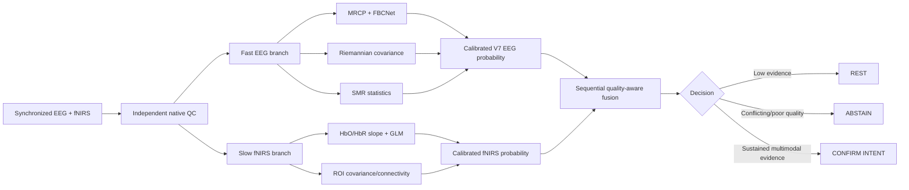

# fNIRS Integration Synopsis for V7

## Executive Decision

Functional near-infrared spectroscopy (fNIRS) is a promising addition to V7,
but it should not replace the current EEG decoder or be appended directly to
its three-second windows. The strongest design is a proposed **V7-H hybrid**:

1. EEG remains the fast, always-available motor-intent detector.
2. fNIRS runs as a slower, quality-gated confirmation or calibration branch.
3. The controller combines calibrated probabilities only when both modalities
   are synchronized and usable.
4. If fNIRS quality is poor or the hardware is absent, the system falls back to
   the conservative EEG-only V7 operating point.

This design matches the physiology. EEG measures fast electrical activity and
can respond within the cue-locked interval, while fNIRS measures a delayed
hemodynamic response that commonly develops over several seconds. fNIRS is
therefore better suited to rehabilitation feedback, FES confirmation, patient
calibration, and false-activation rejection than to sub-second prosthetic
commands.

The proposed extension is a research plan, not a new V7 result. The current V7
benchmark contains EEG only, so its existing recordings cannot be
retrospectively converted into an EEG-fNIRS benchmark.

## Current V7 Reference

V7 performs binary REST-versus-INTENT decoding while retaining left/right
labels only as optional internal calibration evidence. Its current conservative
development-observed result on later recordings is:

| Metric | V7 result |
|---|---:|
| Balanced accuracy | 73.6% |
| Intent sensitivity | 53.5% |
| Rest specificity | 93.7% |
| Intent AUROC | 0.896 |
| Evaluated windows | 4,645 |

V7 combines three EEG representations:

- MRCP plus FBCNet: 60%
- Riemannian covariance: 25%
- Sensorimotor-rhythm statistics: 15%

It then applies dataset-specific calibration, a short patient calibration from
recording 0, and a conservative REST/INTENT gate on later recordings. The
current result is cue-locked. Continuous false activations per minute and the
planned temporal-confirmation rule have not yet been evaluated.

## What fNIRS Could Add

### Complementary physiology

EEG reflects postsynaptic electrical activity with millisecond-scale temporal
resolution. fNIRS estimates changes in oxygenated hemoglobin (HbO) and
deoxygenated hemoglobin (HbR) caused by neurovascular coupling. The two
modalities therefore provide related but non-identical evidence.

For V7, the most useful fNIRS contribution is not necessarily another direction
classifier. It is a second source of evidence that a sustained motor-intent
state occurred. This could help distinguish weak cortical intent from brief
electrical artifacts, provided scalp blood flow and motion are controlled.

### Likely benefits

- Improve confidence in sustained intent during cue-guided rehabilitation.
- Reject some EEG-only false activations when no corresponding hemodynamic
  response develops.
- Provide an additional patient-calibration signal when EEG is weak or
  spatially atypical after stroke.
- Supply neurofeedback about motor-cortex engagement even when no visible
  movement or usable EMG is present.
- Support an EEG-only student model by acting as privileged supervision during
  calibration or training.

### Important limitations

- The hemodynamic delay adds several seconds of command latency.
- Hair, optode contact, skin pigmentation, extracerebral blood flow, systemic
  physiology, and motion can reduce signal quality.
- HbO can remain elevated after a trial, so immediate post-task periods are not
  valid independent REST examples.
- fNIRS hardware increases setup time, cost, synchronization requirements, and
  calibration burden.
- Published gains vary substantially by participant, task, validation design,
  and fusion method.

## Supplied Paper 1: MIND Dataset

Feng et al. introduced the **Multimodal fNIRS-EEG Dataset for Unilateral Limb
Motor Imagery (MIND)** in 2026. It contains simultaneous 64-channel EEG and
51-channel fNIRS from 30 healthy young adults performing four directional
right-upper-limb motor-imagery tasks. Each participant completed 120 imagery
trials. The 10-second imagery period was followed by a 15-second rest interval.

The study used:

- EEG at 1,000 Hz, cleaned with bandpass/notch filtering, bad-channel repair,
  ICA, and ICLabel.
- fNIRS at 47.62 Hz with three wavelengths, scalp-coupling quality checks,
  0.02-0.2 Hz filtering, baseline correction, and 10 Hz output.
- EEG filter-bank CSP plus shrinkage LDA.
- fNIRS HbO/HbR mean and slope features.
- Decision-level fusion of modality scores.

The four-class best-window accuracy increased from 36.19% with EEG alone to
37.53% with EEG, HbO, and HbR. The average improvement was therefore modest and
participant dependent. This is valuable evidence against assuming that adding
fNIRS automatically improves a strong EEG model. The dataset remains highly
useful because it offers synchronized raw data, multiple sessions, quality
metadata, and a reproducible technical-validation pipeline.

**Value to V7:** MIND can support a binary REST-versus-INTENT pilot, a
dual-timescale fusion study, and development of synchronized EEG/fNIRS import
and quality-control code. It cannot by itself establish stroke generalization
because the cohort is young and healthy.

Source: [Feng et al., Scientific Data, 2026](https://doi.org/10.1038/s41597-026-07807-x)

## Supplied Paper 2: Yin et al.

Yin et al. studied simultaneous EEG-fNIRS decoding of imagined hand-clenching
force versus speed in six healthy participants. The study extracted EEG
time-phase-frequency features from mu and beta rhythms, including power,
instantaneous amplitude, phase, and frequency. Its fNIRS features included Hb,
HbO, HbT, and HbD, followed by joint mutual-information feature selection and
an extreme learning machine.

The reported subject-dependent mean accuracies were approximately:

| Input | Mean accuracy |
|---|---:|
| CSP EEG baseline | 73% |
| Combined EEG features | 88% |
| fNIRS concentration features | 76% |
| EEG plus fNIRS | 89% |

The hybrid result was only about one percentage point above the strongest EEG
feature set on average, although some individuals improved more. The experiment
also used long task windows and did not evaluate REST-versus-INTENT, continuous
false activation, unseen subjects, or stroke transfer. The paper explicitly
recognized systemic and superficial fNIRS contamination as limitations.

**Value to V7:** The paper supports modality-specific feature extraction and
late fusion, but it does not justify replacing V7's decoder or expecting a
large accuracy increase. Its strongest transferable idea is to select
complementary features rather than blindly concatenate all EEG and fNIRS
measurements.

Source: [Yin et al., Journal of Neural Engineering, 2015](https://doi.org/10.1088/1741-2560/12/3/036004)

## Broader Research Evidence

| Study | Design | Main lesson for V7 |
|---|---|---|
| [Fazli et al., 2012](https://doi.org/10.1016/j.neuroimage.2011.07.084) | Simultaneous NIRS-EEG sensorimotor BCI | Hybrid MI performance improved by about 5 percentage points on average, but hemodynamic delay can reduce information-transfer rate. |
| [Koo et al., 2015](https://doi.org/10.1016/j.jneumeth.2014.04.016) | Online self-paced MI; NIRS detected occurrence and EEG decoded type | Architecturally close to V7-H: fNIRS can gate intent while EEG supplies faster task information. Mean response time was about 10 seconds, which is too slow for rapid control but plausible for rehabilitation confirmation. |
| [Buccino et al., 2016](https://doi.org/10.1371/journal.pone.0146610) | Asynchronous hybrid interface | HbO/HbR slope features can identify the rising response earlier than waiting for its peak. Most strong results were from executed movement; MI direction remained difficult. |
| [Shin et al., 2017](https://doi.org/10.1109/TNSRE.2016.2628057) | Open simultaneous EEG-NIRS dataset, 29 participants | Best established public starting point for synchronized left/right hand MI development and comparison with MIND. |
| [Li et al., 2023](https://doi.org/10.3389/fnins.2022.1062889) | Y-shaped early-fusion neural model on the Shin dataset | Early fusion reached 76.21% versus 66.09% EEG-only in its validation design. The result motivates an early-fusion comparator, not an assumption of unseen-subject clinical performance. |
| [Chiarelli et al., 2018](https://doi.org/10.1088/1741-2552/aaaf82) | Deep hybrid EEG-fNIRS MI model | Nonlinear cross-modal fusion can be useful when enough synchronized training data exist. Small cohorts still require careful participant-isolated validation. |
| [Mihara et al., 2013](https://doi.org/10.1161/STROKEAHA.111.674507) | fNIRS neurofeedback during upper-limb MI after stroke | fNIRS may have clinical value as brain-contingent rehabilitation feedback, even when its benefit as a rapid command decoder is limited. |
| [Mihara et al., 2021](https://doi.org/10.1212/WNL.0000000000011989) | Randomized stroke neurofeedback trial | Reinforces fNIRS as a feedback and engagement modality for rehabilitation, not only as a classifier input. |

The collective evidence suggests that hybrid benefit is real but conditional.
The largest gains generally appear when the modalities are complementary, the
fusion is calibrated per participant, and the evaluation matches the intended
use. Small subject-dependent studies and cue-locked windows should not be
treated as proof of continuous or cross-patient control.

## Proposed V7-H Architecture

### Fast EEG branch

Keep the current V7 representations, calibration, and conservative operating
point. EEG generates an early candidate probability during approximately the
first 0.5-3 seconds after the cue or candidate onset.

### Slow fNIRS branch

Process fNIRS independently and estimate a sustained intent probability using
early slope and later amplitude/GLM features. A practical confirmation window
is approximately 2-6 seconds after the EEG candidate, with longer evidence
available for rehabilitation feedback.

### Sequential controller

1. Remain in REST while EEG evidence is below threshold.
2. When EEG crosses the candidate threshold, start a short fNIRS evidence
   accumulator.
3. Confirm INTENT only if fNIRS quality is acceptable and multimodal evidence
   crosses a calibrated threshold.
4. Reject or abstain if the modalities disagree, fNIRS quality is poor, or the
   evidence expires.
5. Apply a refractory interval before accepting another command.

This sequence avoids forcing a delayed hemodynamic signal into every rapid EEG
decision. It also makes latency explicit rather than hiding it inside a
cue-locked accuracy score.

## Recommended fNIRS Processing Branch

The implementation should follow current acquisition and preprocessing best
practices, including the recommendations summarized by
[Yucel et al.](https://doi.org/10.1117/1.NPh.8.1.012101).

1. Preserve raw intensity and synchronization triggers.
2. Convert intensity to optical density.
3. Compute source-detector/scalp coupling quality and flag unusable channels.
4. Apply motion correction such as temporal derivative distribution repair
   ([Fishburn et al., 2019](https://doi.org/10.1016/j.neuroimage.2018.09.025)).
5. Regress short-separation channels to reduce superficial physiology. Long
   channels should be paired with nearby short channels when possible
   ([Gagnon et al., 2012](https://doi.org/10.1016/j.neuroimage.2011.08.095)).
6. Convert optical density to HbO and HbR with the modified Beer-Lambert law.
7. Remove drift and retain the slow hemodynamic band, initially 0.02-0.2 Hz for
   comparability with MIND.
8. Baseline-correct using a clean pre-cue interval.
9. Resample the processed branch to 5-10 Hz.
10. Map channels into bilateral M1, premotor, and supplementary-motor ROIs.

### Initial fNIRS features

Start with interpretable features before adding a large deep model:

- HbO and HbR mean change.
- Early and late linear slopes.
- General-linear-model beta weights.
- Area under the response curve.
- Peak amplitude and time to peak.
- HbDiff or oxygenation contrast.
- ROI covariance and functional-connectivity summaries.
- Channel and trial quality scores supplied directly to the rejector.

The fNIRS branch should never convert a poor-quality trial into positive
evidence. Poor coupling, excessive motion, or missing short-separation support
should result in abstention or EEG-only fallback.

## Public-Data Experiment Before New Acquisition

### Datasets

1. **MIND:** 30 healthy participants, simultaneous 64-channel EEG and
   51-channel fNIRS, multi-session upper-limb MI.
2. **Shin EEG-NIRS:** 29 healthy participants, simultaneous 30-channel EEG and
   36-channel fNIRS, repeated left/right hand MI sessions. The dataset is
   available through [NEMAR](https://doi.org/10.82901/nemar.nm000267).

These datasets should first be benchmarked separately because their montages,
timing, hardware, and task definitions differ. Cross-dataset transfer should
be attempted only after a within-dataset implementation audit.

### Binary target

Relabel both datasets to match V7:

- REST: clean pre-cue baseline, dedicated rest blocks, or sufficiently late
  intertrial rest.
- INTENT: any hand/arm motor-imagery trial, with direction retained only as an
  auxiliary label.

Do not use the immediate post-imagery period as an independent REST sample;
the hemodynamic response can persist beyond task offset. Do not mix overlapping
windows across train and test folds.

### Required model comparison

Run the following under identical participant/session isolation:

1. EEG-only V7-compatible branch.
2. fNIRS-only interpretable baseline.
3. Calibrated late fusion.
4. Y-shaped early neural fusion.
5. Sequential EEG proposal plus fNIRS confirmation.
6. fNIRS-teacher to EEG-student privileged transfer.

The teacher-student experiment is especially relevant because it tests whether
fNIRS can improve calibration labels while preserving EEG-only deployment.

### Validation contract

- Keep participants isolated across development, validation, and final test.
- Reserve complete later sessions for evaluation when session structure allows.
- Fit quality thresholds, feature selection, probability calibration, and
  operating thresholds using development data only.
- Preserve dataset identity and report each dataset separately before pooling.
- Use fixed neural seeds and report their distribution, not only the best run.
- Freeze the final controller before evaluating a locked test partition.

## Proposed Prospective Acquisition Protocol

### Hardware and synchronization

- EEG: sensorimotor coverage compatible with V7, with optional full-head EEG.
- fNIRS: bilateral M1, premotor cortex, and SMA coverage.
- Long source-detector separations near 30 mm.
- Short-separation channels near 8-15 mm for superficial regression.
- Shared hardware triggers or a verified synchronization clock.
- EMG, force, and IMU as confirmation channels during data collection, not as
  required deployment inputs.
- Cap layout digitization or standardized spatial registration.

### Session structure

1. Two to five minutes of eyes-open REST.
2. A no-control block with natural blinking, swallowing, and posture changes.
3. Randomized left/right visual or auditory cues.
4. Approximately 2 seconds of preparation.
5. Approximately 8-10 seconds of motor imagery.
6. Approximately 15-20 seconds of jittered rest to permit hemodynamic recovery.
7. Recording 0 reserved for patient calibration.
8. Later recordings reserved for frozen evaluation.

Healthy participants should establish acquisition reliability before a locked
stroke cohort is enrolled. Stroke analyses should retain lesion side, affected
hand, impairment score, medication, fatigue, session, and time-since-stroke as
prespecified metadata.

## Evaluation Endpoints

### Primary deployment endpoints

- False activations per minute during continuous no-control periods.
- Intent sensitivity at a prespecified false-activation limit.
- Median and 90th-percentile confirmed-command latency.
- Missed-intent rate.
- Abstention rate and reasons for abstention.

### Secondary endpoints

- Balanced accuracy, specificity, AUROC, and precision-recall AUC.
- Calibration error and reliability diagrams.
- Performance by dataset, participant, session, and stroke status.
- EEG-only fallback performance.
- Fraction of trials rejected for EEG or fNIRS quality.
- Calibration duration and participant setup time.

Window specificity must not be presented as false activations per minute. The
latter requires a continuous no-control experiment with the complete temporal
controller running.

### Suggested advancement rule

Advance V7-H only if, on a locked matched test set, it provides at least one of
the following without materially worsening latency or calibration burden:

- Higher intent sensitivity at the same prespecified rest specificity as V7.
- Lower false activations per minute at the same intent sensitivity.
- Better patient-level calibration or lower between-session performance loss.

An accuracy increase alone is insufficient if it comes from longer windows,
cue leakage, or a clinically unusable delay.

## GUI and Software Changes

The current GUI can be prepared for fNIRS without changing the validated EEG
path:

- Add SNIRF as the preferred fNIRS import format, with MAT/CSV adapters where
  dataset-specific support is necessary.
- Add an EEG-fNIRS trigger-alignment audit before feature extraction.
- Display source-detector coupling, short-separation availability, motion
  intervals, and usable-channel maps.
- Plot synchronized EEG probability, HbO/HbR response, quality score, fused
  probability, and controller state over time.
- Add an explicit modality state: `EEG_ONLY`, `HYBRID`, `FNIRS_POOR_QUALITY`,
  or `MISSING_MODALITY`.
- Keep the existing V7 model bundle loadable and unchanged.
- Save all preprocessing parameters, optode geometry, thresholds, calibration
  models, and synchronization audit results in the run manifest.

## Phased Implementation Plan

### Implementation status: 2026-08-14

The first MIND-only V7-H benchmark is now implemented. It includes the official
ScienceDB derivative downloader, paired EEG/HbO/HbR import, interpretable EEG
and fNIRS feature branches, participant-isolated population training,
recording-0 patient calibration, quality-aware late fusion, sequential
confirmation, GUI launch support, saved models, metrics, predictions, and four
figures. The Shin adapter, early neural fusion, and fNIRS-teacher transfer
remain future controlled comparisons. Synthetic output is used only for
software verification and is not a scientific result.

### Phase 1: Reproduce published public-data baselines

- MIND adapter implemented; add the Shin adapter next.
- Reproduce basic EEG-only and fNIRS-only results.
- Verify event timing, units, geometry, and quality masks.

### Phase 2: Build V7-H research benchmark

- Create matched binary REST/INTENT windows.
- Compare EEG-only, fNIRS-only, late fusion, early fusion, sequential fusion,
  and privileged teacher-student transfer.
- Use participant/session-isolated evaluation and repeated neural seeds.

### Phase 3: Integrate the best branch into the GUI

- Add synchronized import, QC visualization, state-machine replay, and latency
  reporting.
- Preserve EEG-only fallback.

### Phase 4: Prospective healthy-participant pilot

- Freeze the acquisition protocol.
- Collect continuous no-control data and later-session evaluations.
- Select the operating point based on false activations per minute and latency.

### Phase 5: Locked stroke validation

- Freeze preprocessing, fusion weights, and thresholds.
- Use early calibration only.
- Evaluate later sessions without retuning.

## Final Recommendation

Integrating fNIRS is scientifically justified, but the target should be
**safer confirmation and better calibration**, not simply a higher cue-locked
accuracy. The best next experiment is a participant-isolated MIND plus Shin
benchmark that compares V7-compatible EEG against fNIRS-only, calibrated late
fusion, sequential confirmation, and fNIRS-teacher transfer.

For eventual rehabilitation use, the preferred controller is:

> Fast EEG proposes motor intent; fNIRS confirms sustained cortical engagement;
> quality failure produces abstention or conservative EEG-only fallback.

This preserves V7's main strength, high rest rejection, while testing whether
fNIRS can recover more true intent without creating unsafe commands. It also
creates a defensible path from public-data development to synchronized healthy
acquisition and then locked stroke validation.

## References

1. Feng L, et al. A Multimodal fNIRS-EEG Dataset for Unilateral Limb Motor Imagery. *Scientific Data*. 2026. [doi:10.1038/s41597-026-07807-x](https://doi.org/10.1038/s41597-026-07807-x).
2. Yin X, et al. A hybrid BCI based on EEG and fNIRS signals improves the performance of decoding motor imagery of both force and speed of hand clenching. *Journal of Neural Engineering*. 2015. [doi:10.1088/1741-2560/12/3/036004](https://doi.org/10.1088/1741-2560/12/3/036004).
3. Fazli S, et al. Enhanced performance by a hybrid NIRS-EEG brain computer interface. *NeuroImage*. 2012. [doi:10.1016/j.neuroimage.2011.07.084](https://doi.org/10.1016/j.neuroimage.2011.07.084).
4. Koo B, et al. A hybrid NIRS-EEG system for self-paced brain computer interface with online motor imagery. *Journal of Neuroscience Methods*. 2015. [doi:10.1016/j.jneumeth.2014.04.016](https://doi.org/10.1016/j.jneumeth.2014.04.016).
5. Buccino AP, et al. Hybrid EEG-fNIRS Asynchronous Brain-Computer Interface for Multiple Motor Tasks. *PLOS ONE*. 2016. [doi:10.1371/journal.pone.0146610](https://doi.org/10.1371/journal.pone.0146610).
6. Shin J, et al. Open Access Dataset for EEG+NIRS Single-Trial Classification. *IEEE Transactions on Neural Systems and Rehabilitation Engineering*. 2017. [doi:10.1109/TNSRE.2016.2628057](https://doi.org/10.1109/TNSRE.2016.2628057).
7. Li R, Zhang M, Ming D. Early-stage fusion of EEG and fNIRS improves classification of motor imagery. *Frontiers in Neuroscience*. 2023. [doi:10.3389/fnins.2022.1062889](https://doi.org/10.3389/fnins.2022.1062889).
8. Chiarelli AM, et al. Deep learning for hybrid EEG-fNIRS BCI: application to motor imagery classification. *Journal of Neural Engineering*. 2018. [doi:10.1088/1741-2552/aaaf82](https://doi.org/10.1088/1741-2552/aaaf82).
9. Mihara M, et al. Near-infrared spectroscopy-mediated neurofeedback enhances efficacy of motor imagery-based training in poststroke victims. *Stroke*. 2013. [doi:10.1161/STROKEAHA.111.674507](https://doi.org/10.1161/STROKEAHA.111.674507).
10. Mihara M, et al. Effect of Neurofeedback Facilitation on Poststroke Gait and Balance Recovery: A Randomized Controlled Trial. *Neurology*. 2021. [doi:10.1212/WNL.0000000000011989](https://doi.org/10.1212/WNL.0000000000011989).
11. Yucel MA, et al. Best practices for fNIRS publications. *Neurophotonics*. 2021. [doi:10.1117/1.NPh.8.1.012101](https://doi.org/10.1117/1.NPh.8.1.012101).
12. Fishburn FA, et al. Temporal derivative distribution repair for motion correction of fNIRS data. *NeuroImage*. 2019. [doi:10.1016/j.neuroimage.2018.09.025](https://doi.org/10.1016/j.neuroimage.2018.09.025).
13. Gagnon L, et al. Short separation channel location impacts the performance of short channel regression in NIRS. *NeuroImage*. 2012. [doi:10.1016/j.neuroimage.2011.08.095](https://doi.org/10.1016/j.neuroimage.2011.08.095).
