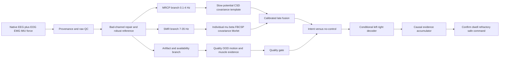

# Full Project Audit: Weak Motor-Intent EEG for Rehabilitation BCI

**Audit date:** July 27, 2026  
**Scope:** Datasets, acquisition, preprocessing, artifact control,
physiological characterization, feature extraction, decoding, transfer,
calibration, continuous control, evaluation, and translational study design.

> **Implementation status:** Recommendations 1-7 and the software preparation
> for recommendation 8 are implemented in
> [`TRANSLATIONAL_V3_IMPLEMENTATION.md`](TRANSLATIONAL_V3_IMPLEMENTATION.md).
> Prospective acquisition and clinical validation remain future work.

## Executive Verdict

The project has not reached an intrinsic accuracy limit of EEG. It has reached
the limit of what can be learned and credibly evaluated from the current
retrospective, cue-locked datasets.

The present pipeline is already stronger than a conventional classifier
benchmark. It uses subject-isolated splits, hierarchical intent/direction
decoding, covariance representations, controlled ablations, patient
calibration, and false-activation metrics. Those components should be kept.

The principal remaining problem is **target mismatch**, not insufficient model
complexity:

- The intended product is an asynchronous rehabilitation controller, but most
  training examples are short windows aligned to known visual cues.
- "Rest" has different meanings across datasets. It may be a T0 cue, a
  post-task interval, or a constructed stage within a stroke trial. None is an
  adequate representation of unrestricted clinical idle time.
- The common seven-channel clinical representation permits cross-dataset
  compatibility, but sacrifices the full montage needed for robust bad-channel
  detection, independent-component cleaning, and spatial filtering.
- The active clinical preprocessing starts at 4 Hz, excluding most of the
  movement-related cortical potential (MRCP) that can precede attempted
  movement.
- Thresholds can exchange false activations for missed intents, but they cannot
  create class separability. The project's continuous experiment demonstrates
  this limitation.
- Repeated exploratory use of the current "final" stroke cohort means it should
  now be considered development-observed, not a pristine confirmatory test.

The highest-value redesign is:

> **Full-montage, quality-aware preprocessing -> separate MRCP and
> sensorimotor-rhythm representations -> hierarchical quality/intent/direction
> decoders -> calibrated late fusion -> causal temporal confirmation -> locked
> subject/session/dataset evaluation -> prospective cue-gated calibration with
> EOG, EMG, force, and motion validation.**

Large neural networks are not the next priority. They should be tested only
after the data definition, physiological representations, and validation
protocol are corrected.

## 1. Audit Basis

### 1.1 Local project evidence reviewed

The audit uses the current code, experiment reports, and generated metrics:

- [`EEG_MOTOR_INTENT_RESEARCH_PROJECT.md`](EEG_MOTOR_INTENT_RESEARCH_PROJECT.md)
- [`BCI_FULL_WORKFLOW_RESEARCH.md`](BCI_FULL_WORKFLOW_RESEARCH.md)
- [`artifacts/healthy_to_stroke_hand_intent/HEALTHY_TO_STROKE_REPORT.md`](artifacts/healthy_to_stroke_hand_intent/HEALTHY_TO_STROKE_REPORT.md)
- [`artifacts/harmonized_physionet_openbmi/HARMONIZED_BENCHMARK_REPORT.md`](artifacts/harmonized_physionet_openbmi/HARMONIZED_BENCHMARK_REPORT.md)
- [`artifacts/openbmi_controlled/OPENBMI_CONTROLLED_REPORT.md`](artifacts/openbmi_controlled/OPENBMI_CONTROLLED_REPORT.md)
- [`artifacts/multibranch_benchmark/MULTIBRANCH_BENCHMARK_RESULTS.md`](artifacts/multibranch_benchmark/MULTIBRANCH_BENCHMARK_RESULTS.md)
- [`artifacts/controlled_ablation/CONTROLLED_ABLATION_RESULTS.md`](artifacts/controlled_ablation/CONTROLLED_ABLATION_RESULTS.md)
- [`artifacts/continuous_fusion/CONTINUOUS_FUSION_RESULTS.md`](artifacts/continuous_fusion/CONTINUOUS_FUSION_RESULTS.md)
- [`artifacts/psd_morlet_fusion_ablation/`](artifacts/psd_morlet_fusion_ablation/)
- [`bci_pipeline/preprocessing.py`](bci_pipeline/preprocessing.py)
- [`bci_pipeline/epochs.py`](bci_pipeline/epochs.py)
- [`bci_pipeline/clinical_transfer.py`](bci_pipeline/clinical_transfer.py)
- [`bci_pipeline/harmonized_motor_imagery.py`](bci_pipeline/harmonized_motor_imagery.py)
- [`bci_pipeline/openbmi_benchmark.py`](bci_pipeline/openbmi_benchmark.py)
- [`bci_pipeline/openbmi_controlled.py`](bci_pipeline/openbmi_controlled.py)
- [`bci_pipeline/continuous.py`](bci_pipeline/continuous.py)

### 1.2 External evidence reviewed

The literature search covered:

- Motor-imagery and attempted-movement physiology
- Clinical stroke BCI and rehabilitation trials
- EEG referencing, bad-channel detection, ICA, ASR, and epoch rejection
- CSP, filter-bank CSP, Riemannian geometry, compact CNNs, transformers, and
  transfer learning
- Cross-dataset and cross-subject validation
- Asynchronous brain switches and false-activation control
- Healthy, stroke, longitudinal, multimodal, and artifact-labeled datasets

The evidence inventory lists every paper or official dataset article used in
this audit.

## 2. Current Pipeline: What It Actually Measures

### 2.1 Current experimental objective

The project now correctly treats the primary problem as:

1. Detect **motor intent versus no intent**.
2. Classify **left versus right** only after intent is accepted.
3. Suppress commands through confidence, quality, OOD, and temporal rules.
4. Transfer from healthy participants to unseen stroke participants with
   limited patient calibration.

This hierarchy is more clinically defensible than a flat left/right/rest
classifier.

### 2.2 Current datasets

| Dataset | Current role | Strength | Important limitation |
|---|---|---|---|
| PhysioNet EEGMMIDB | Healthy source and benchmark | 109 subjects, 64 channels, public and reproducible | Cue-locked task; T0 is protocol rest, not unrestricted idle |
| OpenBMI | Healthy controlled benchmark | Two-session design; strong published baseline | Local copy has 29 complete subjects; paired "rest" is post-task |
| Liu acute-stroke | Stroke transfer and calibration | 50 acute-stroke participants; EOG available | Different device, protocol, montage, impairment, and negative-class construction |

The official EEGMMIDB description confirms 109 subjects, 64 EEG channels,
160 Hz sampling, and 14 runs with task-dependent T1/T2 meanings
([PhysioNet EEGMMIDB](https://physionet.org/content/eegmmidb/1.0.0/)).
OpenBMI contains 54 healthy participants over two sessions, while the Liu
dataset contains 50 acute-stroke participants and 2,000 left/right
motor-imagery trials
([Lee et al., 2019](https://pmc.ncbi.nlm.nih.gov/articles/PMC6501944/);
[Liu et al., 2024](https://pmc.ncbi.nlm.nih.gov/articles/PMC10811218/)).

### 2.3 Current preprocessing and representations

The active branches use combinations of:

- 4-35 or 4-38 Hz band-pass filtering
- Common-average reference
- Resampling to 100 Hz
- Seven- or nine-channel motor-region intersections
- Fixed peak-to-peak artifact rejection
- Covariance and tangent-space features
- Welch band-power and statistical features
- Morlet time-frequency summaries
- Slow-potential, morphology, SSD, asymmetry, phase, and CSD ablations
- Euclidean/log-Euclidean alignment

The project also has a causal continuous-window path with temporal evidence and
hysteresis. This separation between trial-level and continuous experiments is
correct and should remain.

### 2.4 Current performance pattern

The exact result varies by dataset and operating point, but the stable pattern
is:

- OpenBMI intent detection can be strong after alignment and patient
  calibration, while left/right transfer remains close to chance.
- Healthy-to-stroke transfer is substantially harder than within-dataset
  decoding.
- A safety threshold can reduce trial false activations to roughly 6-10%, but
  missed intents then become high.
- In the causal continuous test, a safety configuration reached approximately
  1.06 false activations/minute but detected only 8.8% of intent events. A
  sensitivity-oriented configuration detected approximately 70.9% but produced
  7.94 false activations/minute.
- The Morlet/statistical fusion branch improved intent sensitivity in some
  settings, but did not produce a reliable balanced-accuracy advantage and
  increased false activations.

These results show that the system has learned real cue-locked structure, but
that current evidence is not sufficiently specific for safe always-on control.

## 3. Severity-Ranked Audit Findings

### Critical 1: The negative class does not represent deployment

The target device must remain inactive during natural idle EEG containing
blinks, speech, swallowing, jaw tension, posture changes, therapist contact,
device vibration, attention shifts, and unrelated thought. The current negative
examples are much narrower:

- EEGMMIDB T0 intervals are embedded in a repetitive cue task.
- OpenBMI rest is extracted from a fixed post-task period in the same trial.
- Liu rest is a protocol-defined trial stage.

This makes ordinary trial specificity an optimistic estimate of device safety.
It also explains why thresholds that appear acceptable at the trial level can
produce multiple false activations per minute in a sliding-window stream.

**Decision:** Reframe training around **control versus no-control** and collect
or source hard negative continuous data. Do not treat paired post-task rest as
equivalent to clinical idle.

Asynchronous BCI studies similarly treat false positives per minute as a
separate design objective. A cue-constrained stroke system reported about
0.52 false positives/minute versus 0.99 in asynchronous operation, despite
similar true-positive rates
([Niazi et al., 2022](https://pmc.ncbi.nlm.nih.gov/articles/PMC9082379/); attempted ankle dorsiflexion).
A recent self-paced movement study illustrates the difficulty from the other
direction: only 31.8% true positives at a maximum of one false positive/minute
([Miao et al., 2025](https://pubmed.ncbi.nlm.nih.gov/40007882/)).

### Critical 2: The clinical band excludes a major intent signal

Movement-related cortical potentials are slow changes that can begin up to
approximately two seconds before voluntary movement. Their small amplitude
makes them vulnerable to drift, eye activity, and movement contamination
([Jochumsen et al., 2015](https://pmc.ncbi.nlm.nih.gov/articles/PMC4487719/);
[Shakeel et al., 2015](https://pmc.ncbi.nlm.nih.gov/articles/PMC5492875/)).

A 4 Hz high-pass removes most of this information. The project has explored a
slow branch in PhysioNet, but the harmonized clinical transfer path does not yet
carry a dedicated low-frequency MRCP representation through the entire
healthy-to-stroke experiment.

**Decision:** Implement parallel causal branches:

- **MRCP:** approximately 0.05/0.1-4 Hz
- **Sensorimotor rhythm (SMR):** approximately 6/7-35 Hz
- **Quality/artifact:** broadband and auxiliary sensors

Fuse decisions late. Do not force MRCP and mu/beta ERD into one filter or one
normalization.

### Critical 3: Cross-dataset differences are confounded with disease

Healthy and stroke datasets differ in amplifier, reference, montage, sampling
rate, session design, cue timing, rest definition, participant age, movement
capability, medication, and artifact prevalence. A healthy-versus-stroke
feature difference therefore cannot currently be attributed to stroke
physiology alone. Cross-dataset performance changes substantially with
acquisition and protocol
([Rodrigues et al., 2019](https://pubmed.ncbi.nlm.nih.gov/30596565/);
[Al-Saegh et al., 2021](https://pmc.ncbi.nlm.nih.gov/articles/PMC7188358/)).

**Decision:** Use existing datasets to develop robust methods, but reserve
claims about pathology for a prospective protocol recorded with the same
hardware, timing, instructions, and auxiliary sensors in healthy and stroke
groups.

### Critical 4: The current final cohort is no longer confirmatory

Multiple feature, threshold, fusion, and ablation decisions have now been
viewed on the same final stroke subjects. Even without fitting model weights to
those labels, repeated selection based on final outcomes creates researcher
adaptation to the test set.

EEG segment-level leakage and test-set reuse can substantially overestimate
generalization, particularly when samples from the same person or recording are
correlated
([Kapoor and Narayanan, 2023](https://pmc.ncbi.nlm.nih.gov/articles/PMC11099244/)).

**Decision:** Rename the current cohort **development-observed**. Lock a new
external subject/session cohort before the next claim-bearing experiment.

### High 5: Preprocessing order is not sufficiently quality-aware

The common reference is currently applied before a robust bad-channel repair
stage. A high-amplitude or unstable electrode can therefore contaminate the
average and spread its noise to every channel. The fixed peak-to-peak gate also
catches only a subset of artifacts.

PREP estimates a robust reference and detects noisy channels iteratively
([Bigdely-Shamlo et al., 2015](https://pmc.ncbi.nlm.nih.gov/articles/PMC4471356/)).
Autoreject can learn channel- and participant-specific repair thresholds rather
than relying on one global amplitude cutoff
([Jas et al., 2017](https://pmc.ncbi.nlm.nih.gov/articles/PMC7243972/)).

**Decision:** Detect and repair bad channels before CAR/CSD, retain a
per-recording quality report, and make epoch availability an explicit outcome.

### High 6: Early channel intersection discards spatial information

Reducing each dataset to seven shared channels before source cleaning simplifies
fusion but weakens bad-channel consensus, ICA, CSD, subject-specific spatial
filters, and separation of occipital cue responses from central activity.

Surface Laplacian/CSD can improve motor-imagery localization, but its benefit
depends on enough electrodes during preprocessing
([Kayser and Tenke, 2015](https://pmc.ncbi.nlm.nih.gov/articles/PMC4537832/);
[Liu et al., 2017](https://pubmed.ncbi.nlm.nih.gov/28715332/)).

**Decision:** Clean and characterize each dataset in its full native montage.
Map to common physiological representations or calibrated probabilities only
after dataset-specific spatial processing.

### High 7: Artifact rejection is not artifact attribution

An amplitude gate can reject extreme movement, but it cannot determine whether
a plausible mu/beta change came from cortical activity, eye movement, jaw EMG,
or residual limb activation.

ICA with ICLabel can provide reproducible component labels
([Pion-Tonachini et al., 2019](https://pmc.ncbi.nlm.nih.gov/articles/PMC6592775/)).
ASR can suppress high-variance transients, but its cutoff is task-dependent and
aggressive settings may remove neural activity
([Chang et al., 2020](https://pmc.ncbi.nlm.nih.gov/articles/PMC7560919/)).

**Decision:** Compare robust reference alone, ICA/ICLabel, ASR, and
ICA-plus-ASR using physiology preservation and held-out performance. Retain EOG
and EMG as validation channels rather than deleting them from the data model.

### High 8: The cue can be decoded without decoding intent

Visual evoked responses, anticipation, timing, and trial structure can be
correlated with the requested action. Cue-locked EEG contains both voluntary
motor activity and exogenous sensory responses
([Pfurtscheller et al., 2013](https://pmc.ncbi.nlm.nih.gov/articles/PMC3607307/)).

The project's early occipital control performs above chance, while later
directional information is weaker. This is evidence that cue information is
present, not necessarily that motor intent is decoded.

**Decision:** Separate warning, instruction, and go events; randomize their
delays; use identical go cues; include no-go and observation-only catch trials;
and validate topography and timing.

### High 9: Direction is not yet a reliable cross-patient command

Across current experiments, intent-versus-rest performance can improve while
left/right direction remains close to chance in unseen participants. Large
clinical studies also show that a meaningful subgroup of stroke participants
cannot initially produce decodable imagery
([Ang et al., 2011](https://pubmed.ncbi.nlm.nih.gov/22208123/)).

**Decision:** Keep direction as a secondary, patient-calibrated head. The
initial device action should be triggered by reliable intent plus an external
task context, not by a generalized left/right model alone.

### Medium 10: Hand-built features are producing diminishing returns

The controlled ablations show that morphology, SSD, phase, asymmetry, and
Morlet summaries can be physiologically useful, but have not produced a stable
subject-level clinical gain over covariance/statistical anchors.

**Decision:** A new feature must pass three gates:

1. Plausible physiological timing/topography
2. Within-person, cross-session repeatability
3. Locked subject-level incremental value with a confidence interval

### Medium 11: Offline and online preprocessing are not identical

Zero-phase filtering and cue-complete epochs are useful for retrospective
physiology, but use future samples and cannot be deployed causally. The
continuous branch is causal, yet offline results can still be misread as
expected online performance.

**Decision:** Maintain two explicit profiles:

- **Scientific/offline:** zero-phase, used only for characterization
- **Deployable/causal:** causal filters, fixed buffering, measured algorithmic
  latency, used for every command claim

### Medium 12: Accuracy is not the correct primary endpoint

Balanced accuracy is useful for development, but a rehabilitation controller is
an event-detection and risk-management system. A 70% balanced accuracy can be
unusable if overlapping windows create frequent device commands.

**Decision:** Use sensitivity at a fixed false-activation budget as the primary
endpoint, with latency, abstention, and missed-intent rate. Report direction
accuracy only after a correctly accepted intent.

## 4. Interpreting the Accuracy Ceiling

Published values should not be compared without matching the validation
protocol:

- OpenBMI reported mean motor-imagery performance around 71.1%, but this is not
  completely unseen-patient, healthy-to-stroke, asynchronous control
  ([Lee et al., 2019](https://pmc.ncbi.nlm.nih.gov/articles/PMC6501944/)).
- The Liu acute-stroke article reported 72.21% for its proposed analysis, but
  that value does not establish an always-on intent detector
  ([Liu et al., 2024](https://www.nature.com/articles/s41597-023-02787-8)).
- A clinical motor-imagery study reported mean offline performance of 0.74,
  with six of 54 patients at chance; a smaller repeatedly trained group later
  reached higher online performance. This supports calibration and
  co-adaptation, not a universal zero-calibration decoder
  ([Ang et al., 2011](https://pubmed.ncbi.nlm.nih.gov/22208123/)).
- A large multi-dataset benchmark found strong classical Riemannian pipelines
  and showed that deep models benefit more when training data are sufficiently
  large. Dataset and evaluation choices materially change rankings
  ([Chevallier et al., 2024](https://arxiv.org/abs/2404.15319);
  [Jayaram and Barachant, 2018](https://arxiv.org/abs/1805.06427)).

The project's roughly 60-70% subject-held-out results are plausible for a
difficult transfer setting. The important gap is between cue-locked
classification and safe continuous intent detection.

## 5. Recommended Pipeline Version 3



### 5.1 Data and provenance contract

Every recording should preserve:

- Original units and scaling
- Hardware, cap, coordinates, reference, and sampling rate
- Subject, session, run, trial, cue, and event identifiers
- Exact filtering and resampling history
- Clinical metadata where available
- EOG, EMG, force, IMU, and device-state channels
- Rejection reasons, not only a retained/rejected flag

Use a BIDS-like structure and machine-readable dataset card. Cache fingerprints
must include all processing parameters and source file identities.

### 5.2 Continuous quality control before epoching

For each native full-montage recording:

1. Verify units, channel labels, and event alignment.
2. Quantify flat channels, clipping, drift, line-noise ratio, high-frequency
   muscle ratio, electrode pops, and channel correlation.
3. Detect bad channels with robust statistics/RANSAC.
4. Interpolate bad EEG channels where appropriate.
5. Estimate a robust reference.
6. Apply notch filtering only when line noise is present.
7. Compare ICA/ICLabel and ASR as controlled cleaning ablations.
8. Record retained data percentage and physiology-preservation metrics.

Cleaning should be fit on continuous training/calibration data, never on a
held-out test segment.

### 5.3 Parallel physiological representations

#### MRCP branch

- Passband: approximately 0.05/0.1-4 Hz
- Characterization interval: approximately -2.0 to +0.5/1.0 seconds
- Features: mean amplitude, negative slope, peak negativity, rebound, template
  correlation, low-frequency covariance, and CSD topography
- Deployment: causal running baseline and drift control

MRCP may precede overt movement, but its amplitude is small and EOG-sensitive.
It should never be accepted without artifact evidence.

#### SMR branch

- Passband: approximately 6/7-35 Hz
- Participant-specific mu and beta bands estimated from training/calibration
- Features: log band power, baseline-relative ERD, FBCSP, CSD,
  covariance/tangent space, hemispheric contrast, and Morlet trajectory
- Evaluate early and sustained imagery rather than one fixed crop

ERD/ERS remains a central motor-imagery marker
([Pfurtscheller and Lopes da Silva, 1999](https://pubmed.ncbi.nlm.nih.gov/10576479/)).
Morlet maps should remain because they reveal onset, duration, frequency, and
topography. Their summaries should enter the command decoder only if they add
locked subject-level value.

#### Quality and OOD branch

- Broadband residual statistics
- EOG component probability
- EMG high-frequency power
- Channel availability and impedance
- Motion/force evidence
- Distance from calibration covariance distribution
- Missing-data and saturation indicators

This branch should be allowed to return **unavailable**, not force a class.

### 5.4 Decoder hierarchy

#### Level 0: Signal availability

Reject or pause when quality is inadequate. Report unavailable time as a
clinical metric.

#### Level 1: Intent versus no-control

Use a calibrated ensemble of:

- Riemannian covariance/tangent-space logistic regression
- Filter-bank CSP with regularized LDA/logistic regression
- MRCP template or covariance classifier

Riemannian covariance methods preserve multichannel spatial structure
([Barachant et al., 2012](https://pubmed.ncbi.nlm.nih.gov/22010143/)).
FBCSP remains a competitive interpretable comparator
([Ang et al., 2012](https://pubmed.ncbi.nlm.nih.gov/22479236/)).

#### Level 2: Direction or command

Run left/right only after Level 1 accepts intent. Train direction primarily on
the patient's calibration trials, initialized from a population prior.

#### Level 3: Temporal command policy

Use consecutive-window confirmation, evidence decay, separate on/off
thresholds, a refractory period, artifact cooldown, maximum command duration,
and optional task-context arming. An arming cue may open a time window but must
not itself trigger the device.

### 5.5 Domain and patient adaptation

Do not concatenate all datasets and assume more rows solve domain shift.
Instead:

- Keep dataset/device identity as a domain variable.
- Normalize within recording/session using training-safe statistics.
- Use dataset-specific preprocessing and optional domain-specific heads.
- Test Riemannian alignment using calibration data only.
- Fit late-fusion weights on development subjects.
- Adapt a small number of parameters for each patient.
- Plot performance against calibration time/trials.

Riemannian Procrustes alignment and tangent-space methods provide principled
transfer baselines
([Rodrigues et al., 2019](https://pubmed.ncbi.nlm.nih.gov/30596565/);
[Mellot et al., 2023](https://pmc.ncbi.nlm.nih.gov/articles/PMC9755175/)).
Cross-dataset pretraining may help after target fine-tuning, but does not
replace calibration
([Kostas et al., 2023](https://pubmed.ncbi.nlm.nih.gov/37774694/)).

### 5.6 Deep-learning ladder

Use deep learning in this order:

1. EEGNet compact baseline
2. Small raw-window temporal/spatial CNN
3. Self-supervised pretraining on unlabeled continuous EEG
4. Small conformer only if the effective training set supports it
5. Foundation-model transfer as an exploratory comparator

EEGNet is a compact architecture designed across BCI paradigms
([Lawhern et al., 2018](https://pubmed.ncbi.nlm.nih.gov/29932424/)).
EEG Conformer combines convolutional local features with attention, but extra
capacity does not correct label, rest, or domain mismatch
([Song et al., 2023](https://pubmed.ncbi.nlm.nih.gov/37015413/)).
Self-supervised motor-imagery work is promising for cross-subject learning
([Zhang et al., 2024](https://pubmed.ncbi.nlm.nih.gov/38565100/)), but every
comparison must preserve subject and session isolation.

## 6. Dataset Strategy

### 6.1 Immediate additions

| Dataset | Participants/sessions | Best use | Do not use it to claim |
|---|---:|---|---|
| Complete OpenBMI | 54, two sessions | Healthy calibration and drift | Stroke generalization |
| Cho et al. MI | 52 | Independent healthy transfer | Continuous no-control safety |
| Dreyer et al. | 87, high trial count | Inter-user variability and noisy sessions | Stroke physiology |
| Pan et al. | 25 over five days | Longitudinal drift | Acute stroke transfer |
| Kaya et al. | 13 over 75 sessions | Long-term co-adaptation | Population generalization |
| HS chronic-stroke | 14 over 278 sessions | Chronic-stroke adaptation | Subject-held-out performance from cross-trial results |
| UET175 post-stroke | 30 | Independent stroke external test | Same-domain performance without adapter checks |
| PhysioMotion Artifact | 30 | Train and validate quality gate | Motor-intent labels |
| EEG-EMG wrist movement | 45 healthy | Motor physiology and EMG leakage | Imagery performance |
| IACKD EEG/kinematics | 15 | MRCP, ERD, beta rebound | Stroke imagery transfer |

Dataset reports:

- [Cho et al., 2017](https://pmc.ncbi.nlm.nih.gov/articles/PMC5493744/)
- [Dreyer et al., 2023](https://www.nature.com/articles/s41597-023-02445-z)
- [Pan et al., 2022](https://www.nature.com/articles/s41597-022-01647-1)
- [Kaya et al., 2018](https://www.nature.com/articles/sdata2018211)
- [HS chronic-stroke dataset, 2026](https://www.nature.com/articles/s41597-026-07742-x)
- [UET175 post-stroke dataset, 2025](https://pmc.ncbi.nlm.nih.gov/articles/PMC12209182/)
- [PhysioMotion Artifact dataset, 2026](https://www.nature.com/articles/s41597-026-07120-7)
- [Synchronized EEG-EMG wrist dataset, 2026](https://www.nature.com/articles/s41597-026-07287-z)
- [IACKD EEG and kinematics dataset, 2026](https://www.nature.com/articles/s41597-026-07146-x)

### 6.2 How to combine datasets

Build adapters that produce a common **semantic contract**, not merely an
identical tensor:

```text
dataset
subject
session
run
trial
event type
control/no-control semantics
task and effector
cue timing
window timing
native channels
reference
quality labels
auxiliary movement evidence
```

Train with dataset-balanced sampling and compare:

1. Dataset-specific models
2. Shared representation plus domain-specific heads
3. Population model plus patient calibration
4. Leave-one-dataset-out transfer

Do not allow the largest dataset to dominate the loss, and do not report pooled
window accuracy without per-dataset and per-subject results.

## 7. Prospective Experiment Needed to Break the Wall

Public data can refine the pipeline, but the deployment questions require a
controlled prospective study.

### 7.1 Recommended calibration trial

Each trial should contain:

1. Neutral warning cue
2. Random delay
3. Left/right or act/no-act instruction
4. Random delay
5. Visually and acoustically identical go cue
6. Kinesthetic imagery or attempted movement
7. Relaxation
8. Sparse confidence/fatigue ratings

Randomized delays prevent the decoder from exploiting a fixed timeline.
Include no-go, observation-only, cue-only, passive-movement, attempted-movement,
and natural-idle catch trials. Natural idle should contain blinking, speaking,
swallowing, jaw tension, and therapist interaction.

### 7.2 Sensors

Acquire:

- Full-montage EEG
- Vertical and horizontal EOG
- Bilateral surface EMG
- Force, bend, or grip sensor
- Wrist/limb IMU
- Hardware event trigger or photodiode

Initially, auxiliary signals should validate whether EEG predictions precede or
follow muscle/motion. They should not be silently used as model inputs to claim
an EEG-only result.

### 7.3 Participant characterization

Record:

- Age, sex, handedness, affected side, and time since stroke
- Motor impairment score such as Fugl-Meyer
- Lesion location and corticospinal tract integrity where available
- Medication, fatigue, sleep, and attention
- Kinesthetic and Visual Imagery Questionnaire score
- Detectable EMG/force and usable EEG time

The KVIQ was developed for people with physical disabilities and has reported
reliability in stroke
([Malouin et al., 2007](https://pubmed.ncbi.nlm.nih.gov/17419886/)).
Clinical response may also depend on residual corticospinal integrity
([Sebastian-Romagosa et al., 2024](https://pubmed.ncbi.nlm.nih.gov/38245782/)).

### 7.4 Staged study design

#### Stage 1: Healthy feasibility

- Same proposed clinical hardware and protocol
- Repeated sessions, not one visit
- Early calibration; later blocks and days locked
- Cue-gated and self-paced comparison
- Realistic hard negatives and distractions

#### Stage 2: Stroke feasibility

- Start with cue-gated rehabilitation, not unrestricted prosthetic control
- Use patient calibration and an abstaining decoder
- Evaluate repeated sessions and calibration retention
- Analyze by impairment and signal availability

#### Stage 3: Closed-loop rehabilitation

Deliver contingent visual, haptic, robotic, or FES feedback only after accepted
intent. The clinical rationale is associative timing between cortical intent
and afferent feedback, not classification accuracy alone. Controlled studies
have reported promising but heterogeneous motor benefits
([Ramos-Murguialday et al., 2013](https://pubmed.ncbi.nlm.nih.gov/23494615/);
[Biasiucci et al., 2018](https://pubmed.ncbi.nlm.nih.gov/29925890/);
[Cervera et al., 2024](https://pubmed.ncbi.nlm.nih.gov/39391265/)).

## 8. Validation and Reporting Contract

### 8.1 Required splits

- **Development subjects:** preprocessing, feature, and model choices
- **Controller subjects:** thresholds and temporal policy
- **Locked final subjects:** one-time evaluation only
- **External dataset:** independent domain test
- **Prospective later session/day:** deployment-relevant confirmation

All learned operations, including artifact thresholds, individualized bands,
alignment, imputation, scaling, feature selection, calibration, and fusion,
must be fit without final data.

### 8.2 Required metrics

#### Primary

- Event sensitivity at a fixed false-activation rate
- False activations per minute/hour
- Missed-intent rate
- Detection latency
- False command duration
- Unavailable/abstained time

#### Secondary

- Balanced accuracy
- Rest specificity
- Intent precision and F1
- Conditional left/right accuracy
- Macro F1
- Calibration error, Brier score, and reliability curves

#### Reliability

- Median and interquartile range by participant
- Worst-quartile participant performance
- Subject-level bootstrap confidence intervals
- Test-retest reliability across runs and sessions
- Calibration curves at 0, 2, 5, 10, and 20 trials/class or by minutes
- Performance by quality, impairment, and imagery-ability strata

### 8.3 Advancement gates

The current research target can remain:

- At most 1 false activation/minute
- At least 60% event sensitivity
- At most 2.5 seconds median latency

That is a useful **cue-gated feasibility** target, not automatically a safe
prosthetic requirement. Self-paced use may require a much lower false-activation
rate based on formal device hazard analysis.

No model advances unless the improvement:

1. Is measured on locked subjects
2. Has a subject-level confidence interval
3. Preserves causal deployability
4. Improves the operating point, not only unconstrained accuracy
5. Does not depend primarily on cue, artifact, or overt movement

## 9. Keep, Change, and Stop

### Keep

- Subject-isolated and run/session-aware splits
- Hierarchical intent then direction decoding
- Riemannian covariance/tangent-space baseline
- FBCSP and regularized linear baselines
- Controlled ablation framework
- Patient calibration curves
- False-activation, missed-intent, and latency reporting
- Morlet, ERD/ERS, PSD, and scalp maps for physiological audit
- Dataset adapters, cache fingerprints, and reproducible artifacts
- Cue leakage and early-occipital controls

### Change now

- Rename the current final stroke cohort to development-observed
- Add a new locked external cohort before claim-bearing selection
- Define a common semantic event contract
- Repair bad channels before CAR and retain full-montage preprocessing
- Carry MRCP and SMR branches through clinical transfer
- Replace fixed artifact thresholds with quality-aware comparisons
- Preserve EOG and available movement channels
- Use domain-specific preprocessing/heads instead of naive pooled rows
- Add hard no-control states and continuous negative recordings
- Enforce offline/causal parity for command claims
- Make sensitivity at fixed false activations the primary result

### Stop

- Adding arbitrary feature families to the same fixed windows
- Treating post-task rest as unrestricted clinical idle
- Using threshold tuning as the main solution to poor separability
- Claiming healthy/stroke differences are disease effects when protocols differ
- Comparing cross-trial paper accuracy with subject-held-out transfer accuracy
- Reporting pooled window accuracy as the headline result
- Treating a cue decoder as a motor-intent decoder
- Training a large transformer before correcting the data target
- Reusing the same final cohort for repeated model selection

## 10. Prioritized Work Plan

### Priority 0: Scientific reset, 1-2 weeks

1. Freeze current reports as the exploratory baseline.
2. Mark the Liu final cohort as development-observed.
3. Create dataset/event cards documenting rest and intent semantics.
4. Create one metric registry for trial and continuous experiments.
5. Complete the 54-subject OpenBMI download if feasible.
6. Pre-register the next retrospective comparison and locked test.

**Expected value:** Prevents further test-set adaptation and makes later gains
interpretable.

### Priority 1: Signal and physiology redesign, 3-6 weeks

1. Add full-montage QC, bad-channel repair, robust reference, and quality
   reports.
2. Add dataset-specific CSD and ICA/ASR controlled ablations.
3. Implement the clinical MRCP branch beside the SMR branch.
4. Estimate individualized mu/beta bands from calibration data.
5. Add scalp maps, time-frequency maps, ERD trajectories, MRCP waveforms,
   repeatability, and artifact-association plots.
6. Require feature-family incremental-value confidence intervals.

**Expected value:** Determines whether weak intent is absent, inconsistent, or
hidden by the current representation.

### Priority 2: Transfer and decoder redesign, 4-8 weeks

1. Compare FBCSP, Riemannian, MRCP, and calibrated late fusion.
2. Add shared representation with dataset-specific heads.
3. Evaluate leave-one-subject, leave-one-session, and leave-one-dataset-out.
4. Plot calibration benefit by trial count and time.
5. Add EEGNet only as a compact raw-window baseline.
6. Test self-supervised pretraining only after validation is locked.

**Expected value:** Separates gains from population pretraining, domain
adaptation, and patient calibration.

### Priority 3: Prospective healthy pilot

Recruit a modest repeated-session healthy cohort using the intended clinical
hardware and trial protocol. Include hard negatives, EOG, bilateral EMG, IMU,
force, and exact event timing.

**Expected value:** This is the first experiment capable of estimating whether
the redesigned system detects EEG intent rather than cue timing or movement
artifact under realistic continuous conditions.

### Priority 4: Stroke feasibility and closed-loop study

Begin with cue-gated, therapist-supervised feedback and an abstaining decoder.
Progress toward self-paced use only after the operating point and failure modes
are clinically acceptable. Complete formal sample-size and device-risk analyses
with clinical and statistical collaborators.

## 11. Recommended Next Experiment

The next experiment should **not** be another classifier sweep.

Run a pre-registered, subject-isolated ablation with:

- Native full-montage preprocessing
- Robust QC before referencing
- MRCP, SMR, and quality branches
- Riemannian and FBCSP anchors
- Calibrated late fusion
- Dataset-specific heads
- Causal replay
- Existing development subjects for selection
- A newly locked external subject/session set for one-time evaluation

Report intent sensitivity at one false activation/minute, detection latency,
unavailable time, conditional direction accuracy, patient-level distributions,
calibration burden, and physiology/artifact-association figures.

This directly tests the audit's central hypothesis: the current ceiling is
caused more by signal definition, physiology coverage, and domain mismatch than
by decoder capacity.

## 12. Evidence Inventory

### Datasets and benchmarking

1. PhysioNet. EEG Motor Movement/Imagery Dataset.
   [Official dataset](https://physionet.org/content/eegmmidb/1.0.0/)
2. Lee MH et al. EEG dataset and OpenBMI toolbox for three BCI paradigms.
   [GigaScience, 2019](https://pmc.ncbi.nlm.nih.gov/articles/PMC6501944/)
3. Cho H et al. EEG datasets for motor imagery BCI.
   [GigaScience, 2017](https://pmc.ncbi.nlm.nih.gov/articles/PMC5493744/)
4. Liu et al. Acute-stroke motor-imagery EEG dataset.
   [Scientific Data, 2024](https://www.nature.com/articles/s41597-023-02787-8)
5. Dreyer P et al. Large motor-imagery dataset for BCI inefficiency.
   [Scientific Data, 2023](https://www.nature.com/articles/s41597-023-02445-z)
6. Pan J et al. Longitudinal motor-imagery dataset.
   [Scientific Data, 2022](https://www.nature.com/articles/s41597-022-01647-1)
7. Kaya M et al. Long-term EEG BCI dataset.
   [Scientific Data, 2018](https://www.nature.com/articles/sdata2018211)
8. HS chronic-stroke longitudinal motor-imagery dataset.
   [Scientific Data, 2026](https://www.nature.com/articles/s41597-026-07742-x)
9. UET175 post-stroke EEG motor-imagery dataset.
   [Data in Brief, 2025](https://pmc.ncbi.nlm.nih.gov/articles/PMC12209182/)
10. PhysioMotion Artifact Dataset.
    [Scientific Data, 2026](https://www.nature.com/articles/s41597-026-07120-7)
11. Synchronized EEG, EMG, and wrist-kinematics dataset.
    [Scientific Data, 2026](https://www.nature.com/articles/s41597-026-07287-z)
12. IACKD EEG and kinematics dataset.
    [Scientific Data, 2026](https://www.nature.com/articles/s41597-026-07146-x)
13. Jayaram V, Barachant A. MOABB.
    [Journal of Neural Engineering preprint, 2018](https://arxiv.org/abs/1805.06427)
14. Chevallier S et al. Large-scale MOABB evaluation.
    [Preprint, 2024](https://arxiv.org/abs/2404.15319)

### Preprocessing and signal quality

15. Bigdely-Shamlo N et al. PREP pipeline.
    [Frontiers in Neuroinformatics, 2015](https://pmc.ncbi.nlm.nih.gov/articles/PMC4471356/)
16. Pion-Tonachini L et al. ICLabel.
    [NeuroImage, 2019](https://pmc.ncbi.nlm.nih.gov/articles/PMC6592775/)
17. Chang CY et al. Evaluation of ASR cutoff values.
    [IEEE TNSRE, 2020](https://pmc.ncbi.nlm.nih.gov/articles/PMC7560919/)
18. Jas M et al. Autoreject.
    [NeuroImage, 2017](https://pmc.ncbi.nlm.nih.gov/articles/PMC7243972/)
19. Kayser J, Tenke CE. Current source density methods.
    [Clinical Neurophysiology, 2015](https://pmc.ncbi.nlm.nih.gov/articles/PMC4537832/)
20. Liu Q et al. CSD spatial filtering for motor imagery.
    [Journal of Neural Engineering, 2017](https://pubmed.ncbi.nlm.nih.gov/28715332/)

### Motor physiology and cue confounds

21. Pfurtscheller G, Lopes da Silva FH. ERD/ERS review.
    [Clinical Neurophysiology, 1999](https://pubmed.ncbi.nlm.nih.gov/10576479/)
22. Jochumsen M et al. Temporal and spectral MRCP features.
    [Sensors, 2015](https://pmc.ncbi.nlm.nih.gov/articles/PMC4487719/)
23. Shakeel A et al. MRCP detection and artifact challenges.
    [Computational and Mathematical Methods in Medicine, 2015](https://pmc.ncbi.nlm.nih.gov/articles/PMC5492875/)
24. Pfurtscheller G et al. Cue-related and voluntary EEG activity.
    [Frontiers in Neuroscience, 2013](https://pmc.ncbi.nlm.nih.gov/articles/PMC3607307/)
25. Malouin F et al. Kinesthetic and Visual Imagery Questionnaire.
    [Journal of Neurologic Physical Therapy, 2007](https://pubmed.ncbi.nlm.nih.gov/17419886/)

### Decoders and transfer

26. Ang KK et al. Filter Bank Common Spatial Pattern.
    [Frontiers in Neuroscience, 2012](https://pubmed.ncbi.nlm.nih.gov/22479236/)
27. Barachant A et al. Riemannian covariance classification.
    [IEEE TBME, 2012](https://pubmed.ncbi.nlm.nih.gov/22010143/)
28. Lawhern VJ et al. EEGNet.
    [Journal of Neural Engineering, 2018](https://pubmed.ncbi.nlm.nih.gov/29932424/)
29. Song Y et al. EEG Conformer.
    [IEEE TNSRE, 2023](https://pubmed.ncbi.nlm.nih.gov/37015413/)
30. Rodrigues PLC et al. Riemannian Procrustes Analysis.
    [IEEE TBME, 2019](https://pubmed.ncbi.nlm.nih.gov/30596565/)
31. Mellot A et al. Tangent-space alignment across datasets.
    [Frontiers in Human Neuroscience, 2023](https://pmc.ncbi.nlm.nih.gov/articles/PMC9755175/)
32. Kostas D et al. Cross-dataset pretraining for EEG decoding.
    [Journal of Neural Engineering, 2023](https://pubmed.ncbi.nlm.nih.gov/37774694/)
33. Zhang et al. Self-supervised cross-subject motor-imagery decoding.
    [IEEE TNSRE, 2024](https://pubmed.ncbi.nlm.nih.gov/38565100/)
34. Al-Saegh A et al. Cross-dataset motor-imagery variability.
    [Frontiers in Human Neuroscience, 2021](https://pmc.ncbi.nlm.nih.gov/articles/PMC7188358/)

### Asynchronous and clinical BCI

35. Niazi IK et al. Associative cued asynchronous BCI induces cortical plasticity in stroke patients.
    [Annals of Clinical and Translational Neurology, 2022](https://pmc.ncbi.nlm.nih.gov/articles/PMC9082379/)
36. Miao et al. Self-paced movement detection at controlled false positives.
    [Journal of Neural Engineering, 2025](https://pubmed.ncbi.nlm.nih.gov/40007882/)
37. Ang KK et al. Motor-imagery BCI ability in stroke.
    [Clinical EEG and Neuroscience, 2011](https://pubmed.ncbi.nlm.nih.gov/22208123/)
38. Ramos-Murguialday A et al. BCI rehabilitation after stroke.
    [Annals of Neurology, 2013](https://pubmed.ncbi.nlm.nih.gov/23494615/)
39. Biasiucci A et al. Brain-actuated functional electrical stimulation.
    [Nature Communications, 2018](https://pubmed.ncbi.nlm.nih.gov/29925890/)
40. Cervera MA et al. BCI-FES rehabilitation meta-analysis.
    [Clinical Rehabilitation, 2024](https://pubmed.ncbi.nlm.nih.gov/39391265/)
41. Sebastian-Romagosa et al. Severe-stroke BCI and CST integrity.
    [Journal of NeuroEngineering and Rehabilitation, 2024](https://pubmed.ncbi.nlm.nih.gov/38245782/)

### Validation

42. Kapoor S, Narayanan A. Leakage and reproducibility in ML science.
    [Patterns, 2023](https://pmc.ncbi.nlm.nih.gov/articles/PMC11099244/)

## Final Recommendation

The project should continue, but its next phase should be described as
**translational signal validation and patient adaptation**, not a search for a
single universally accurate classifier.

The strongest PhD-level contribution would be a reproducible framework that
answers:

1. Which EEG intent signatures are physiologically present and repeatable in a
   given patient?
2. How much calibration is required to detect them?
3. How does performance change across sessions and recovery?
4. Can a quality-aware, abstaining, cue-gated controller provide feedback with
   an acceptable false-activation and latency burden?
5. Which patient and signal characteristics predict success or non-use?

That framing remains valuable even if no single decoder reaches a headline
accuracy. It converts the current "accuracy wall" into a clinically meaningful
program about signal availability, calibration, reliability, and safe
closed-loop rehabilitation.
